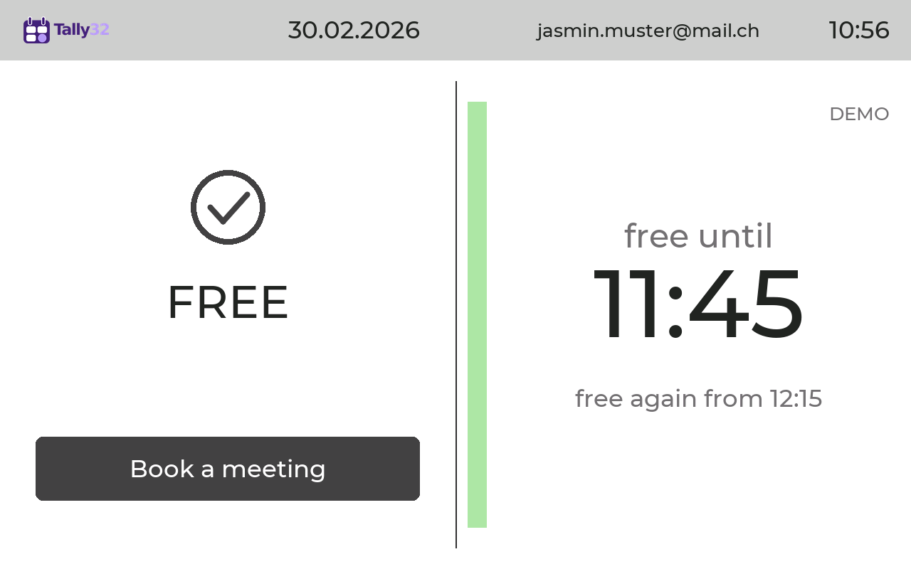
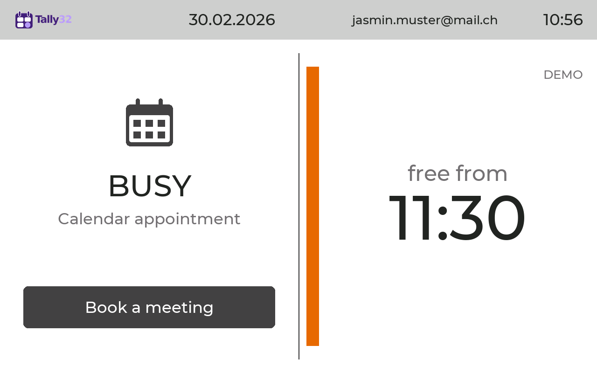
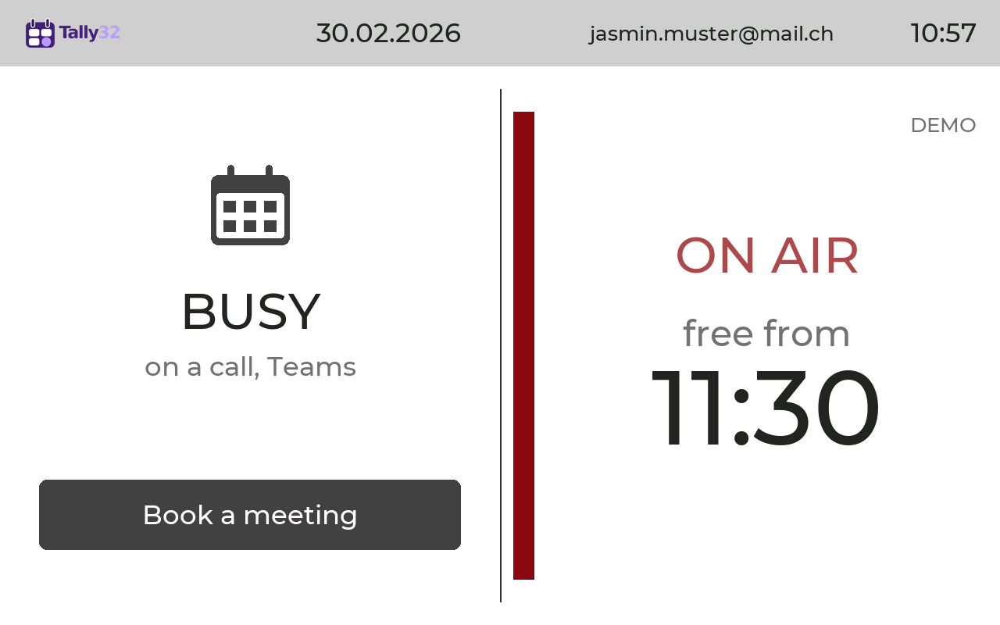
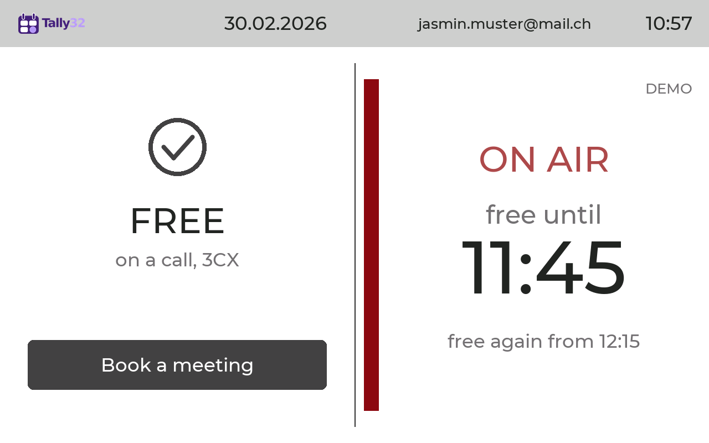
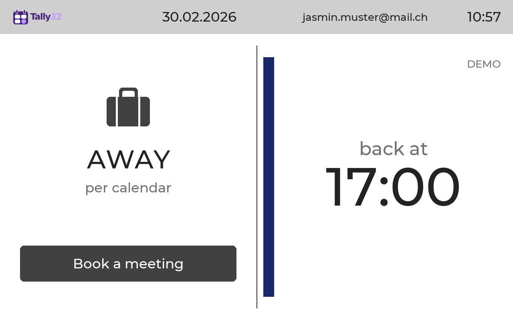
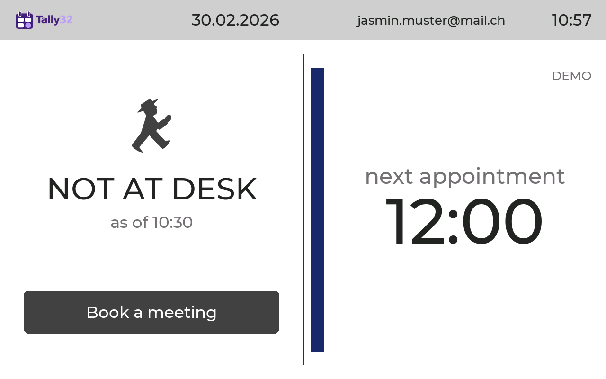
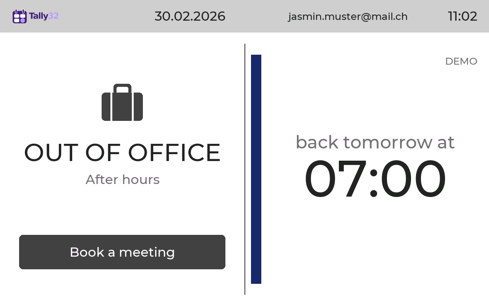
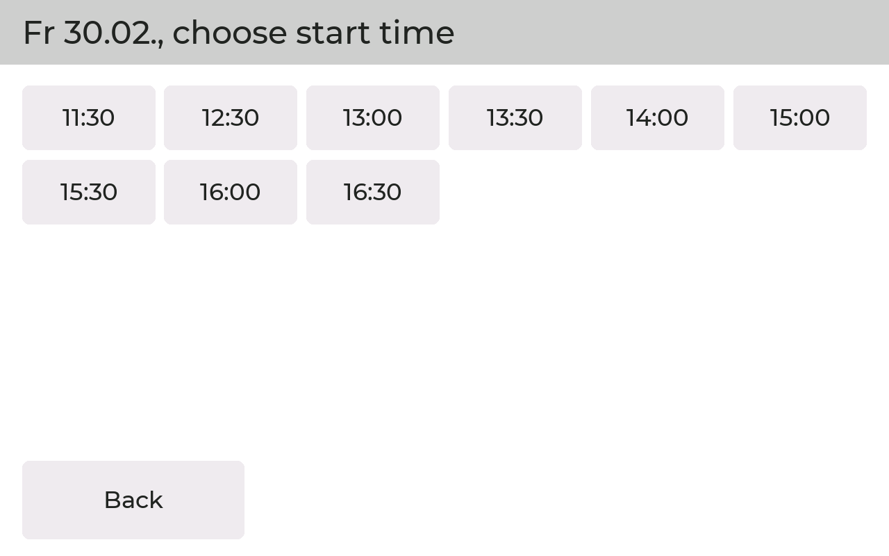

# Tally32

Statusanzeige für den Arbeitsplatz auf einem ESP32 Display (GUITION 7" oder 10,1"),
angeschlossen per USB. Zeigt wie ein Tally Light im Studio, ob man gerade telefoniert,
und aus dem Outlook Kalender, ob man besetzt ist und **ab wann man wieder frei ist**.

**English:** [see below](#english)

**Ausführliche Anleitung mit Bildern: [docs/Anleitung.md](docs/Anleitung.md)**
(englisch: [docs/Manual.md](docs/Manual.md))

Flyer: [Deutsch](docs/Tally32_Basic_Flyer.pdf), [English](docs/Tally32_Basic_Flyer_EN.pdf).
Spec Sheet für die IT: [Deutsch](docs/Tally32_Agent_SpecSheet_ICT.pdf), [English](docs/Tally32_Agent_SpecSheet_IT_EN.pdf).

| Zustand | Anzeige | Auslöser |
|---|---|---|
| ON AIR / IM GESPRÄCH | "ON AIR" pulsierend über der Zeit, darunter der normale Zustand mit seinen Zeiten (z. B. BESETZT "frei ab", FREI "frei bis"), links "im Gespräch" mit Quelle (Teams, 3CX …) | Mikrofon belegt oder Teams `InACall` / `Presenting` |
| BESETZT | Kalender Symbol, "frei ab 14:30" | Termin mit `showAs` busy, oder Teams "Nicht stören" |
| ABWESEND | Koffer, "zurück ab 17:00" | Termin mit `showAs` oof oder workingElsewhere, oder Teams Abwesend / Gleich zurück |
| FREI | Häkchen, "frei bis 15:00" (nächster Termin), darunter "danach wieder frei ab 16:00" | sonst |
| NICHT AM PLATZ | Ampelmännchen, "nächster Termin 13:00", "Stand 09:29" | Notebook weg, laut Kalender gerade kein Termin |
| AUSSER HAUS | Koffer, "Feierabend" oder "Arbeitsfreier Tag", "zurück morgen ab 07:00" | ausserhalb der Arbeitszeit (frühester Beginn, spätestes Ende und Wochentage aus den Buchungseinstellungen), ersetzt FREI und NICHT AM PLATZ. Nach 2 Minuten ohne Berührung Bildschirmschoner |
| KEIN SIGNAL | durchgestrichener Kreis | keine Daten vom Agent und kein gültiger Offline-Puffer |

### So sieht es aus

Bildschirmfotos vom Gerät (10", Demomodus, Beispielkonto jasmin.muster@mail.ch, erzeugt mit
`tools/screenshot.py --demo`, das Beispielkonto setzt die Variable `TALLY32_SHOT_NAME`):

| | |
|---|---|
|  |  |
|  |  |
|  |  |
|  |  |

Alle Bilder liegen in [docs/screens](docs/screens).

### Ohne Notebook (abgedockt)

Der Agent schickt alle 30 Sekunden die Uhrzeit und die Terminblöcke von heute
und morgen ans Display. Wird das Notebook abgesteckt (oder schläft es), rechnet
das Display damit selbst weiter: in einem Termin BESETZT mit "zurück ca."
bzw. ABWESEND mit "zurück ab", sonst NICHT AM PLATZ mit dem nächsten Termin.
Dazu steht immer "Stand HH:MM", also wann die Daten zuletzt aktualisiert wurden.
Der Knopf "Termin buchen" ist ohne Notebook ausgeblendet. Die Daten gelten
höchstens 16 Stunden, nach einem Stromausfall zeigt das Display KEIN SIGNAL,
bis das Notebook wieder verbunden ist.

Wichtig: Das Display an die Dockingstation oder an ein eigenes USB-Netzteil
hängen, nicht direkt ans Notebook, sonst ist es beim Abdocken aus. Manche Docks
(z. B. HP USB-C Dock G5) schalten beim Abdocken kurz den Strom ab, das Display
startet dann neu. Die Terminblöcke speichert es deshalb im Flash, die Uhrzeit hält
die Echtzeituhr auf dem Board. Dafür muss im Halter eine **Knopfzelle CR1220**
stecken, sonst zeigt das Display nach so einem Neustart KEIN SIGNAL. Ob die Uhr
läuft, steht im Menü unter Info ("Echtzeituhr").

Aufbau: hellgraue Kopfzeile mit Logo, Datum, Name und Uhrzeit. Darunter weiss, links
Symbol und Zustand (und der Knopf "Termin buchen"), in der Mitte eine feine Linie mit
einem schmalen Balken in der Statusfarbe (frei grün, im Gespräch rot, besetzt orange,
abwesend dunkelblau, kein Signal grau), rechts die Zeit. Oben rechts das Symbol für die
Verbindung zum Agenten.

Jeder Zustand ist über Text und Symbol erkennbar, nicht nur über die Farbe.
"frei ab" ist das Ende des zusammenhängenden Terminblocks. Lücken bis 5 Minuten
zählen als durchgehend besetzt.

Ein Display pro Rechner, der Agent auf dem Computer liefert alles per USB. Kein
Firmennetz, kein Server.

## Aufbau

```
Mikrofon (CoreAudio / Windows Registry) ┐
Microsoft Graph: Kalender + Presence    ┼→ agent/tally_agent.py → USB Seriell → firmware/ (GUITION 7" oder 10")
```

- `firmware/` PlatformIO Projekt für das GUITION JC1060P470C (ESP32-P4 mit ESP32-C6
  für WLAN, 7" IPS 1024x600 mit Touch, Umgebung `guition-p4`) und das GUITION JC8012P4A1C
  (10,1" IPS 1280x800, Touch GSL3680, Umgebung `guition-p4-10`), quer. Einzige App auf dem ESP32-P4
  (Partition `factory`), startet direkt nach dem Einschalten.

Bezugsquellen der Displays (AliExpress): [GUITION JC1060P470C, 7"](https://de.aliexpress.com/item/1005010023056143.html),
[GUITION JC8012P4A1C, 10,1"](https://de.aliexpress.com/item/1005009147577522.html).

Am Rechner bzw. an der Dockingstation hängt das Display an der **oberen** der
beiden USB-C-Buchsen auf der Rückseite (eingebaute USB-Schnittstelle des ESP32-P4,
Windows zeigt "Serielles USB-Gerät"). An der unteren meldet sich kein Gerät.
- `agent/` Python Agent für macOS und Windows.

## Webinterface

Das Display spannt ein eigenes WLAN auf (WPA2, ohne Internet):

| | Benutzer | Passwort |
|---|---|---|
| WLAN `Tally32-XXXX` | | `tally32setup` |
| Webinterface http://192.168.4.1 | `admin` | `tally32`, muss beim ersten Login geändert werden |

Funktionen: neue Office 365 Anmeldung auslösen (Code und Link erscheinen im
Webinterface und auf dem Display, der Agent auf dem Computer erledigt den Rest),
Sprache (Deutsch oder English), Farben pro Zustand, Name in der Kopfzeile (wessen Kalender das Display zeigt, leer =
angemeldetes Konto, auch im Menü am Gerät unter Anzeige änderbar), Helligkeit und Drehung, WLAN-Passwort, Web-Passwort.
Die Schriftfarbe wählt das Display je nach Helligkeit des Hintergrunds selbst.

### Menü am Display

Die meisten Einstellungen gehen auch ohne WLAN direkt am Display, auch wenn es
nur an einem USB-Netzteil hängt: **3 Sekunden auf das Tally32-Logo oben links
drücken**, dann den PIN eingeben (Standard `0000`, ändern im Menü oder im
Webinterface). Nach 5 falschen Versuchen ist das Menü eine Minute gesperrt,
nach 60 Sekunden ohne Berührung schliesst es sich.

| Kachel | Inhalt |
|---|---|
| Demomodus | starten bzw. beenden, das Menü schliesst sich dabei |
| Anzeige | Helligkeit, Display um 180° drehen, Name in der Kopfzeile |
| Sprache / Language | Deutsch oder English für Display, Webinterface und die Texte des Agenten |
| Farben | sechs Farben pro Zustand, jede mit Helligkeitswert in Prozent |
| Terminbuchung | Knopf ein/aus, Zeitfenster, Wochentage, Mittagspause |
| Microsoft 365 | angemeldetes Konto, neues Konto verbinden (über den Agent) |
| WLAN | Einrichtungs-WLAN ein/aus, Netzname, Passwort, Adresse |
| Info | Version, Display, Verbindung, Konto, Einrichtungs-WLAN mit Adresse, Echtzeituhr, letzter Neustart |
| PIN ändern | neuen PIN zweimal eingeben |

### Terminbuchung am Display

Im Webinterface oder im Menü einschaltbar. Dann zeigt die linke Fläche den Knopf
"Termin buchen". Besucher geben ihre E-Mail-Adresse und einen Titel ein, wählen 15, 30
oder 60 Minuten und eine freie Zeit in der laufenden oder kommenden Woche. Der
Agent legt den Termin im Kalender an und schickt die Einladung. Im Setup
einstellbar: frühester Beginn, spätestes Ende, Mittagspause, Wochentage.
Belegt sind Zeiten mit `showAs` busy, tentative, oof und workingElsewhere.
Höchstens 4 Buchungen pro Stunde. Braucht das Recht `Calendars.ReadWrite`
(nach dem Update einmal neu anmelden, je nach Tenant mit Admin-Freigabe).

Der Buchungsdialog nutzt kantengeglättete Montserrat-Schriften (SIL OFL) mit
echten Umlauten, erzeugt mit `tools/make_vlw.py`.

### Bildschirmschoner

Der Agent meldet, ob der Rechner gesperrt ist (macOS über CoreGraphics,
Windows über WTSSessionInfoEx). Bei gesperrtem Rechner bleibt zuerst die
normale Anzeige. Nach 5 Minuten Sperre startet der Bildschirmschoner: dunkler
Grund, das Logo wandert langsam über den Bildschirm, unten springt "Tap Me"
alle 30 Sekunden eine Position weiter. Antippen zeigt die normale Anzeige (der
Tipp löst sonst nichts aus), nach 2 Minuten ohne Berührung kommt der Schoner
wieder. Entsperren beendet ihn sofort. Kein Schoner im Demomodus, während einer
Buchung oder Anmeldung und ohne Notebook.

### Demomodus

Im Menü am Display oder im Webinterface unter "Demomodus" ein- und ausschalten (bleibt über einen
Neustart erhalten, per USB auch `SET demo 1` / `SET demo 0`). Das Display zeigt
dann reihum alle Zustände (auch AUSSER HAUS), alle 6 Sekunden ein neuer, und führt
einmal pro Runde eine Buchung selbst vor. Besucher können den Knopf "Termin buchen" auch
selbst ausprobieren: Die freien Zeiten sind erfunden (mit Zeitfenster,
Mittagspause und Wochentagen aus dem Setup), gebucht wird nichts. Oben rechts
steht "DEMO". Daten vom Computer werden so lange nicht angezeigt. Ohne
Uhrzeit vom Agent läuft eine Ersatzuhr ab Montag 10:00.

Passwort oder PIN vergessen: 10 Sekunden auf das Display drücken. Danach gelten
wieder die Standardpasswörter und der PIN `0000`.

## Firmware bauen und flashen

```bash
cd firmware && pio run -e guition-p4 -t upload --upload-port /dev/cu.usbmodem31201
```

Für das 10"-Display (GUITION JC8012P4A1C) die Umgebung `guition-p4-10`.

Unter Windows ist der Port das "Serielle USB-Gerät" (z. B. `COM6`). Den Agenten
vorher anhalten, er hält den Port offen.

Für einen sauberen Neustart vorher den ganzen Flash löschen:

```bash
cd firmware && pio run -e guition-p4 -t erase --upload-port /dev/cu.usbmodem31201
```

## Agent

```bash
cd agent && uv venv .venv && uv pip install -p .venv/bin/python -r requirements.txt
```

```bash
agent/.venv/bin/python agent/tally_agent.py login
```

```bash
agent/.venv/bin/python agent/tally_agent.py
```

Weitere Befehle: `status` (einmal ausgeben, ohne Gerät), `demo` (alle Zustände
durchspielen), `logout`.

Zwei Displays an einem Rechner: je Display ein Agent, gewählt über die USB-Seriennummer
(`"port": "sn:<nummer>"` in `config.json` bzw. `agent/install_mac.sh display 2 sn:<nummer>`),
siehe [Anleitung, Abschnitt 9](docs/Anleitung.md#9-zwei-displays-an-einem-computer).

Konfiguration in `~/.config/tally32/config.json`, das Token liegt daneben in
`token_cache.json` (Rechte 600). Ohne Anmeldung läuft nur die Mikrofon Erkennung.

### Autostart auf dem Mac

```bash
agent/install_mac.sh
```

Legt den LaunchAgent `ch.aussie.tally32` an: startet bei der Anmeldung, wird nach
einem Absturz neu gestartet, Log in `~/Library/Logs/tally32.log`. Entfernen mit
`agent/install_mac.sh uninstall`. Nach `login`/`logout` den Agenten neu starten
(Skript nochmals ausführen).

### Windows

Der Agent ist dasselbe Python-Skript wie auf dem Mac. Einrichten (PowerShell im
Ordner `agent`):

```
powershell -ExecutionPolicy Bypass -File .\install_windows.ps1
```

Das legt die venv an, installiert die Pakete und registriert die Aufgabe
"Tally32 Agent" in der Aufgabenplanung (Start bei Anmeldung, unsichtbar, Neustart
nach Absturz). Log: `%LOCALAPPDATA%\tally32\tally32.log`. Entfernen mit
`-Uninstall`. Anmelden bei Microsoft 365:
`.venv\Scripts\python.exe tally_agent.py login` oder über den Knopf im Webinterface.

Testplan (Windows 11, 21.10.2026: Schritte 1 bis 5 bestanden):

1. Display mit der oberen USB-C-Buchse an die Dockingstation anstecken, im Geräte-Manager erscheint
   "Serielles USB-Gerät (COMx)" und "USB JTAG/serial debug unit". Der Treiber
   ist in Windows enthalten.
2. `.venv\Scripts\python.exe tally_agent.py status` läuft ohne Fehler.
3. `.venv\Scripts\python.exe tally_agent.py demo` findet das Display und spielt
   die Zustände ab.
4. Teams- bzw. 3CX-Anruf: Display springt auf ON AIR mit der richtigen Quelle.
5. Win+L, 5 Minuten warten: Bildschirmschoner erscheint, im Log steht
   "Bildschirm gesperrt".
6. `install_windows.ps1`, abmelden und wieder anmelden: Agent startet von selbst.
7. Notebook abdocken: Display zeigt NICHT AM PLATZ bzw. "zurück ca.".

Falls Python auf dem PC nicht erlaubt ist: den Agenten mit PyInstaller zu einer
einzelnen `tally32-agent.exe` verpacken (auf einem Rechner mit Python bauen).

### Konto wechseln (z. B. privates Konto → Firmenkonto)

Im Menü am Display unter "Microsoft 365", im Webinterface "Neue Anmeldung
starten" oder `tally_agent.py login`: das bisherige Konto wird ersetzt. Vorher
`"booking": true` in `config.json` setzen, sonst fehlt das Recht zum Buchen.
Im neuen Tenant braucht es je nach Einstellung eine Admin-Freigabe für die
Rechte `Calendars.ReadBasic`, `Presence.Read` und `Calendars.ReadWrite` (Client
"Microsoft Graph Command Line Tools" oder eine eigene App-Registrierung, siehe
unten). Ohne Freigabe laufen nur Mikrofon und Bildschirmsperre.

Freigabe ohne PowerShell: einmal mit dem Admin-Konto anmelden und bei der
Zustimmung "Consent on behalf of your organization" anhaken. Der Agent lehnt
das Admin-Konto danach ab (kein Postfach, das bisherige Konto bleibt), die
Freigabe gilt aber. Dann mit dem eigenen Konto anmelden. Konten ohne
Exchange-Postfach nimmt der Agent grundsätzlich nicht an.

### Microsoft 365

Standardmässig wird der öffentliche Client "Microsoft Graph Command Line Tools"
mit Device Code Login verwendet (Rechte `Calendars.ReadBasic`, `Presence.Read`,
mit Buchung `Calendars.ReadWrite`, Tenant `common`). Je nach Tenant muss ein Admin die Rechte einmal freigeben,
danach können sich normale Benutzer anmelden. Das angemeldete Konto braucht ein
Exchange Postfach, sonst gibt es nur den Teams Status. Blockiert der Tenant den
Client ganz, eine eigene App Registrierung anlegen (Public Client, "Allow public
client flows" an, delegierte Rechte wie oben) und deren ID als `client_id`
eintragen. Mit `"presence": false` wird nur der Kalender abgefragt.

### Grenzen

- Ein 3CX **Tischtelefon** belegt kein Mikrofon am Computer. Dafür bräuchte es
  die 3CX Call Control API.
- Die Mikrofon Erkennung pro Programm braucht macOS 14.2 oder neuer, ältere
  Versionen erkennen nur "Mikrofon belegt".
- Die Windows Variante ist auf Windows 11 getestet (Mikrofon, Sperre, Bildschirmschoner).
  Noch offen: Autostart nach neuer Anmeldung, Abdocken und Microsoft 365.

## Protokoll (115200 Baud, eine Zeile pro Meldung)

```
HELLO                                       -> TALLY32 1
ST <call|busy|away|free> <HH:MM> <frei_ab> <frei_bis> <quelle> [<free|busy|away>]
```

Das letzte Feld kommt nur bei `call`: der Zustand ohne Gespräch. `frei_ab` und
`frei_bis` gehören dann zu diesem Zustand, das Display zeigt ihn mit pulsierendem
ON AIR darüber.

Leere Felder als `-`, Leerzeichen in der Quelle als `_`. `frei_ab` ist bei
call/busy/away das Ende des laufenden Blocks, bei free das Ende des nächsten
Blocks ("danach wieder frei ab"). Liegt es nicht mehr heute, kommt `TT.MM.`.

Offline-Puffer (Agent an Display, alle 30 s):

```
TM <unix_utc> <utc_offset_s>
LK <0|1>                                   Rechner gesperrt (alle 2 s)
CB <yyyy-mm-dd> <HHMM-HHMMb|a,...|->      b = besetzt, a = abwesend
STATUS                                     -> Diagnose: angezeigter Zustand
```

Terminbuchung:

```
SLOTS <dauer> <früheste_min> <späteste_min> <tage_maske> <mittag_von> <mittag_bis>
SL <yyyy-mm-dd> <wochentag> <HHMM,...|->   ...   SL END
BOOK <yyyy-mm-dd> <HH:MM> <dauer> <email> <titel>
BK OK | BK ERR <text>
```

Einstellungen (bleiben im NVS gespeichert):

```
SET flip 1          Display um 180 Grad drehen
SET bright 180      Helligkeit 12 bis 255
SET demo 1          Demomodus ein (0 = aus)
```

## Lizenz

Tally32 Basic steht unter der **PolyForm Noncommercial License 1.0.0**
([LICENSE.md](LICENSE.md)). Erlaubt ist die Nutzung für nicht kommerzielle Zwecke:
privat sowie durch gemeinnützige Organisationen, Bildungs- und Forschungseinrichtungen
und öffentliche Stellen, auch mit Änderungen und Weitergabe zu diesen Zwecken.

**Kommerzielle Nutzung ist nicht erlaubt**, auch nicht in Teilen: weder der Einsatz in
einem Unternehmen noch der Einbau in ein Produkt oder der Betrieb als Dienst. Dafür gibt
es eine kommerzielle Lizenz. Kontakt: Oliver Timme, hello@timme-security.ch.
Bestandteile Dritter behalten ihre eigenen Lizenzen, sie stehen in [NOTICE.txt](NOTICE.txt).

---

## English

Desk status display on an ESP32 display (GUITION 7" or 10.1"), connected over USB. Like a tally
light in a studio it shows whether you are on a call, and from your Outlook calendar whether you
are busy and **when you will be free again**.

**Detailed manual with pictures: [docs/Manual.md](docs/Manual.md)** (German:
[docs/Anleitung.md](docs/Anleitung.md))

Flyer: [English](docs/Tally32_Basic_Flyer_EN.pdf), [German](docs/Tally32_Basic_Flyer.pdf).
Spec sheet for IT: [English](docs/Tally32_Agent_SpecSheet_IT_EN.pdf), [German](docs/Tally32_Agent_SpecSheet_ICT.pdf).

| State | Display | Trigger |
|---|---|---|
| ON AIR / ON A CALL | pulsing "ON AIR" above the time, below it the normal state with its times (e.g. BUSY "free from", FREE "free until"), on the left "on a call" with the source (Teams, 3CX …) | microphone in use or Teams `InACall` / `Presenting` |
| BUSY | calendar symbol, "free from 14:30" | meeting with `showAs` busy, or Teams "Do not disturb" |
| AWAY | suitcase, "back at 17:00" | meeting with `showAs` oof or workingElsewhere, or Teams Away / Be right back |
| FREE | check mark, "free until 15:00" (next meeting), below it "free again from 16:00" | otherwise |
| NOT AT DESK | walking traffic light man, "next appointment 13:00", "as of 09:29" | notebook gone, no meeting in the calendar right now |
| OUT OF OFFICE | suitcase, "After hours" or "Day off", "back tomorrow at 07:00" | outside working hours (earliest start, latest end and weekdays from the booking settings), replaces FREE and NOT AT DESK. Screen saver after 2 minutes without a touch |
| NO SIGNAL | crossed out circle | no data from the agent and no valid offline buffer |

### What it looks like

Screenshots from the device (10", demo mode, sample account jasmin.muster@mail.ch, created with
`tools/screenshot.py --demo`, the sample account is set by the variable `TALLY32_SHOT_NAME`). The
date 30.02.2026 in the header does not exist, it marks the pictures as demo pictures:

| | |
|---|---|
|  |  |
|  |  |
|  |  |
|  |  |

All pictures are in [docs/screens/en](docs/screens/en) (German: [docs/screens](docs/screens)).

### Without notebook (undocked)

Every 30 seconds the agent sends the time and the meeting blocks of today and tomorrow to the
display. If the notebook is unplugged (or asleep), the display keeps working with this data:
during a meeting BUSY with "back approx." or AWAY with "back at", otherwise NOT AT DESK with the
next appointment. It always shows "as of HH:MM", the time the data was last updated. Without the
notebook the "Book a meeting" button is hidden. The data is valid for at most 16 hours. After a
power cut the display shows NO SIGNAL until the notebook is connected again.

Important: connect the display to the docking station or to its own USB power supply, not
directly to the notebook, otherwise it turns off when you undock. Some docks (e.g. HP USB-C Dock
G5) cut the power briefly when undocking and the display restarts. That is why it stores the
meeting blocks in flash, and the real-time clock on the board keeps the time. This requires a
**CR1220 coin cell** in the holder, otherwise the display shows NO SIGNAL after such a restart.
Whether the clock is running is shown in the menu under Info ("Real-time clock").

Layout: light grey header with logo, date, name and time. Below it on white: on the left the
symbol and state (and the "Book a meeting" button), in the middle a thin line with a narrow bar in
the status colour (free green, on a call red, busy orange, away dark blue, no signal grey), on the
right the time. At the top right the symbol for the connection to the agent.

Every state can be recognised by text and symbol, not only by colour. "free from" is the end of
the continuous block of meetings. Gaps of up to 5 minutes count as continuously busy.

One display per computer. The agent on the computer delivers everything over USB. No company
network, no server.

### Architecture

```
Microphone (CoreAudio / Windows Registry) ┐
Microsoft Graph: calendar + presence      ┼→ agent/tally_agent.py → USB serial → firmware/ (GUITION 7" or 10")
```

- `firmware/` PlatformIO project for the GUITION JC1060P470C (ESP32-P4 with ESP32-C6 for Wi-Fi,
  7" IPS 1024x600 with touch, environment `guition-p4`) and the GUITION JC8012P4A1C (10.1" IPS
  1280x800, touch GSL3680, environment `guition-p4-10`), landscape. The only app on the ESP32-P4
  (partition `factory`), starts right after power on.

Where to buy the displays (AliExpress): [GUITION JC1060P470C, 7"](https://de.aliexpress.com/item/1005010023056143.html),
[GUITION JC8012P4A1C, 10.1"](https://de.aliexpress.com/item/1005009147577522.html).

On the computer or docking station the display is connected to the **upper** of the two USB-C
sockets on the back (built-in USB interface of the ESP32-P4, Windows shows "USB Serial Device").
Nothing shows up on the lower one.
- `agent/` Python agent for macOS and Windows.

### Web interface

The display opens its own Wi-Fi network (WPA2, no internet):

| | User | Password |
|---|---|---|
| Wi-Fi `Tally32-XXXX` | | `tally32setup` |
| Web interface http://192.168.4.1 | `admin` | `tally32`, must be changed at the first sign-in |

Functions: start a new Office 365 sign-in (code and link appear in the web interface and on the
display, the agent on the computer does the rest), language (Deutsch or English), colours per
state, name in the header (whose calendar the display shows, empty = signed-in account, can also
be changed in the device menu under Display), brightness and rotation, Wi-Fi password, web
password. The display picks the text colour by itself depending on the brightness of the
background.

#### Menu on the display

Most settings are also available without Wi-Fi directly on the display, even when it is only
connected to a USB power supply: **press and hold the Tally32 logo at the top left for 3
seconds**, then enter the PIN (default `0000`, change it in the menu or in the web interface).
After 5 wrong attempts the menu is locked for one minute. After 60 seconds without a touch it
closes.

| Tile | Content |
|---|---|
| Demo mode | start or stop, the menu closes |
| Display | brightness, rotate display by 180°, name in the header |
| Sprache / Language | Deutsch or English for the display, the web interface and the texts sent by the agent |
| Colours | six colours per state, each with a brightness value in percent |
| Meeting booking | button on/off, time window, weekdays, lunch break |
| Microsoft 365 | signed-in account, connect new account (via the agent) |
| Wi-Fi | setup Wi-Fi on/off, network name, password, address |
| Info | version, display, connection, account, setup Wi-Fi with address, real-time clock, last restart |
| Change PIN | enter the new PIN twice |

#### Meeting booking on the display

Can be turned on in the web interface or in the menu. The left area then shows the "Book a
meeting" button. Visitors enter their email address and a title, choose 15, 30 or 60 minutes and a
free slot in the current or next week. The agent creates the meeting in the calendar and sends the
invitation. Configurable in the setup: earliest start, latest end, lunch break, weekdays. Times
with `showAs` busy, tentative, oof and workingElsewhere count as taken. At most 4 bookings per
hour. Requires the permission `Calendars.ReadWrite` (sign in once more after the update, depending
on the tenant with admin approval).

The booking dialog uses anti-aliased Montserrat fonts (SIL OFL) with real umlauts, generated with
`tools/make_vlw.py`.

#### Screen saver

The agent reports whether the computer is locked (macOS via CoreGraphics, Windows via
WTSSessionInfoEx). When the computer is locked, the normal screen stays at first. After 5 minutes
of lock the screen saver starts: dark background, the logo moves slowly across the screen, at the
bottom "Tap Me" jumps to a new position every 30 seconds. Tapping shows the normal screen (the tap
does nothing else). After 2 minutes without a touch the screen saver comes back. Unlocking ends it
immediately. No screen saver in demo mode, during a booking or sign-in and without the notebook.

#### Demo mode

Turn it on and off in the menu on the display or in the web interface under "Demo mode" (kept
after a restart, over USB also `SET demo 1` / `SET demo 0`). The display then shows all states in
turn (including OUT OF OFFICE), a new one every 6 seconds, and demonstrates a booking once per
round. Visitors can also try the "Book a meeting" button themselves: the free slots are made up
(with time window, lunch break and weekdays from the setup) and nothing is booked. "DEMO" is shown
at the top right. Data from the computer is not shown during demo mode. Without the time from the
agent a substitute clock runs from Monday 10:00.

Password or PIN forgotten: press the display for 10 seconds. After that the default passwords and
the PIN `0000` apply again.

### Build and flash the firmware

```bash
cd firmware && pio run -e guition-p4 -t upload --upload-port /dev/cu.usbmodem31201
```

For the 10" display (GUITION JC8012P4A1C) use the environment `guition-p4-10`.

On Windows the port is the "USB Serial Device" (e.g. `COM6`). Stop the agent first, it keeps the
port open.

For a clean start erase the whole flash first:

```bash
cd firmware && pio run -e guition-p4 -t erase --upload-port /dev/cu.usbmodem31201
```

### Agent

```bash
cd agent && uv venv .venv && uv pip install -p .venv/bin/python -r requirements.txt
```

```bash
agent/.venv/bin/python agent/tally_agent.py login
```

```bash
agent/.venv/bin/python agent/tally_agent.py
```

Further commands: `status` (print once, without a device), `demo` (play through all states),
`logout`.

Two displays on one computer: one agent per display, selected by the USB serial number
(`"port": "sn:<number>"` in `config.json` or `agent/install_mac.sh display 2 sn:<number>`), see
[Manual, section 9](docs/Manual.md#9-two-displays-on-one-computer).

The agent texts on the display (for example the source of a state) follow the language set on the
display.

Configuration in `~/.config/tally32/config.json`, the token is stored next to it in
`token_cache.json` (permissions 600). Without sign-in only microphone detection runs.

#### Autostart on the Mac

```bash
agent/install_mac.sh
```

Creates the LaunchAgent `ch.aussie.tally32`: starts at login, is restarted after a crash, log in
`~/Library/Logs/tally32.log`. Remove it with `agent/install_mac.sh uninstall`. After
`login`/`logout` restart the agent (run the script again).

#### Windows

The agent is the same Python script as on the Mac. Setup (PowerShell in the `agent` folder):

```
powershell -ExecutionPolicy Bypass -File .\install_windows.ps1
```

This creates the venv, installs the packages and registers the task "Tally32 Agent" in the Task
Scheduler (starts at login, hidden, restarts after a crash). Log:
`%LOCALAPPDATA%\tally32\tally32.log`. Remove it with `-Uninstall`. Sign in to Microsoft 365:
`.venv\Scripts\python.exe tally_agent.py login` or with the button in the web interface.

Test plan (Windows 11, 21.10.2026: steps 1 to 5 passed):

1. Connect the upper USB-C socket of the display to the docking station. Device Manager shows
   "USB Serial Device (COMx)" and "USB JTAG/serial debug unit". The driver is included in Windows.
2. `.venv\Scripts\python.exe tally_agent.py status` runs without errors.
3. `.venv\Scripts\python.exe tally_agent.py demo` finds the display and plays the states.
4. Teams or 3CX call: the display switches to ON AIR with the correct source.
5. Win+L, wait 5 minutes: the screen saver appears, the log says "Bildschirm gesperrt" (screen
   locked).
6. `install_windows.ps1`, sign out and sign in again: the agent starts by itself.
7. Undock the notebook: the display shows NOT AT DESK or "back approx.".

If Python is not allowed on the PC: package the agent with PyInstaller into a single
`tally32-agent.exe` (build it on a computer with Python).

#### Switching accounts (e.g. private account → company account)

In the display menu under "Microsoft 365", in the web interface "Start new sign-in" or with
`tally_agent.py login`: the previous account is replaced. Set `"booking": true` in `config.json`
first, otherwise the permission to book is missing. Depending on its settings the new tenant needs
an admin approval for the permissions `Calendars.ReadBasic`, `Presence.Read` and
`Calendars.ReadWrite` (client "Microsoft Graph Command Line Tools" or your own app registration,
see below). Without approval only microphone and screen lock work.

Approval without PowerShell: sign in once with the admin account and tick "Consent on behalf of
your organization" when asked. The agent then rejects the admin account (no mailbox, the previous
account stays), but the approval is granted. Then sign in with your own account. The agent never
accepts accounts without an Exchange mailbox.

#### Microsoft 365

By default the public client "Microsoft Graph Command Line Tools" is used with device code login
(permissions `Calendars.ReadBasic`, `Presence.Read`, with booking `Calendars.ReadWrite`, tenant
`common`). Depending on the tenant an admin has to approve the permissions once, after that normal
users can sign in. The signed-in account needs an Exchange mailbox, otherwise only the Teams
presence is available. If the tenant blocks the client entirely, create your own app registration
(public client, "Allow public client flows" on, delegated permissions as above) and enter its ID as
`client_id`. With `"presence": false` only the calendar is queried.

#### Limitations

- A 3CX **desk phone** does not use a microphone on the computer. This would need the 3CX Call
  Control API.
- Microphone detection per program needs macOS 14.2 or later. Older versions only detect
  "microphone in use".
- The Windows version is tested on Windows 11 (microphone, lock, screen saver). Still open:
  autostart after a new sign-in, undocking and Microsoft 365.

### Protocol (115200 baud, one line per message)

```
HELLO                                       -> TALLY32 1
ST <call|busy|away|free> <HH:MM> <free_from> <free_until> <source> [<free|busy|away>]
```

The last field is only sent with `call`: the state without the call. `free_from` and `free_until`
then belong to this state, and the display shows it with a pulsing ON AIR above it.

Empty fields as `-`, spaces in the source as `_`. With call/busy/away `free_from` is the end of the
current block, with free it is the end of the next block ("free again from"). If it is no longer
today, it is sent as `DD.MM.`.

Offline buffer (agent to display, every 30 s):

```
TM <unix_utc> <utc_offset_s>
LK <0|1>                                   computer locked (every 2 s)
CB <yyyy-mm-dd> <HHMM-HHMMb|a,...|->      b = busy, a = away
STATUS                                     -> diagnostics: state shown
```

Meeting booking:

```
SLOTS <duration> <earliest_min> <latest_min> <day_mask> <lunch_from> <lunch_until>
SL <yyyy-mm-dd> <weekday> <HHMM,...|->   ...   SL END
BOOK <yyyy-mm-dd> <HH:MM> <duration> <email> <title>
BK OK | BK ERR <text>
```

Settings (stored in NVS):

```
SET flip 1          rotate display by 180 degrees
SET bright 180      brightness 12 to 255
SET demo 1          demo mode on (0 = off)
```

### Licence

Tally32 Basic is licensed under the **PolyForm Noncommercial License 1.0.0**
([LICENSE.md](LICENSE.md)). Use for noncommercial purposes is permitted: private use and use by
charitable organisations, educational and research institutions and public bodies, also with
modifications and distribution for these purposes.

**Commercial use is not permitted**, not even in part: neither use within a company nor
integration into a product nor operation as a service. A commercial licence is available for this.
Contact: Oliver Timme, hello@timme-security.ch. Third-party components keep their own licences,
they are listed in [NOTICE.txt](NOTICE.txt).
