# Tally32 Basic: Anleitung

Tally32 zeigt am Arbeitsplatz, ob Sie gerade telefonieren, in einem Termin sind oder frei sind,
und vor allem **ab wann Sie wieder frei sind**. Besucher sehen das auf einen Blick und können bei
Bedarf direkt am Display einen Termin bei Ihnen buchen.

Tally32 Basic besteht aus einem Display pro Arbeitsplatz und einem kleinen Programm, dem
**Agenten**, auf Ihrem Computer. Der Agent liest Ihren Outlook-Kalender, den Teams-Status und das
Mikrofon und schickt den Zustand per USB-Kabel ans Display. Es braucht weder Firmennetz noch Server.

Alle Bilder in dieser Anleitung stammen direkt vom Gerät (10-Zoll-Display, Demomodus, Beispielkonto
jasmin.muster@mail.ch). Das Datum 30.02.2026 in der Kopfzeile gibt es nicht, es kennzeichnet die
Bilder als Demo-Bilder. Das 7-Zoll-Display sieht genau gleich aus, nur kleiner.

## Inhalt

1. [Was Sie brauchen](#1-was-sie-brauchen)
2. [Die Anzeige im Überblick](#2-die-anzeige-im-überblick)
3. [Die Zustände](#3-die-zustände)
4. [Termin buchen (für Besucher)](#4-termin-buchen-für-besucher)
5. [Inbetriebnahme](#5-inbetriebnahme)
6. [Einstellungen am Display](#6-einstellungen-am-display)
7. [Webinterface](#7-webinterface)
8. [Ohne Notebook, Bildschirmschoner, Demomodus](#8-ohne-notebook-bildschirmschoner-demomodus)
9. [Zwei Displays an einem Computer](#9-zwei-displays-an-einem-computer)
10. [Datenschutz](#10-datenschutz)
11. [Hilfe bei Problemen](#11-hilfe-bei-problemen)
12. [Lizenz](#12-lizenz)

## 1. Was Sie brauchen

| Teil | Hinweis |
|---|---|
| Display GUITION JC1060P470C (7 Zoll, 1024 x 600) oder GUITION JC8012P4A1C (10,1 Zoll, 1280 x 800) | beide mit ESP32-P4 und Touch, im Handel um 50 bzw. 60 Franken. Bezugsquellen: [7 Zoll](https://de.aliexpress.com/item/1005010023056143.html), [10,1 Zoll](https://de.aliexpress.com/item/1005009147577522.html) (AliExpress) |
| USB-C-Kabel mit Datenleitungen | ein reines Ladekabel funktioniert nicht, das Display erscheint dann nicht am Computer |
| Knopfzelle CR1220 (7 Zoll) | hält die Uhrzeit bei einem Stromunterbruch, sonst zeigt das Display danach KEIN SIGNAL, bis der Computer wieder verbunden ist |
| Computer mit macOS (ab 14.2) oder Windows 11 | dort läuft der Agent |
| Microsoft-365-Konto mit Exchange-Postfach | für Kalender, Teams-Status und Terminbuchung. Ohne Konto erkennt Tally32 nur Gespräche über das Mikrofon |

Das Display gehört an die Dockingstation oder an ein eigenes USB-Netzteil, nicht direkt ans Notebook.
Sonst geht es beim Abdocken aus.

## 2. Die Anzeige im Überblick

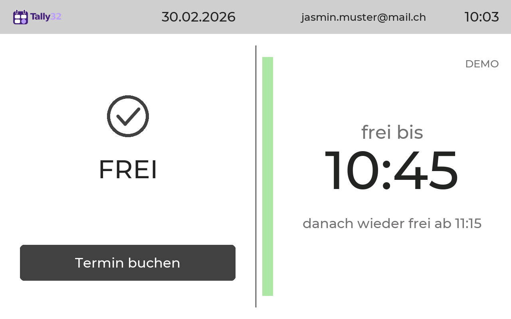

| Bereich | Inhalt |
|---|---|
| **Kopfzeile** (hellgrau) | links das Tally32-Logo, dann das Datum, der Name (oder das angemeldete Konto) und rechts die Uhrzeit |
| **Linke Fläche** | Symbol und Zustand in grossen Buchstaben, darunter die Quelle (zum Beispiel "laut Kalender"). Unten der Knopf **Termin buchen**, wenn die Buchung eingeschaltet ist |
| **Mittellinie** | feine dunkle Linie, rechts daneben ein schmaler **Balken in der Farbe des Zustands** |
| **Rechte Fläche** | die wichtigste Zeit, zum Beispiel "frei bis 10:45", darunter Zusatzinformationen. Oben rechts das Symbol für die Verbindung zum Computer |

Jeder Zustand ist über Text und Symbol erkennbar, die Farbe des Balkens ist nur eine Ergänzung. Die
Farben unterscheiden sich zusätzlich deutlich in der Helligkeit (frei hell, besetzt mittel, Gespräch
und abwesend dunkel). So bleibt die Anzeige auch für farbenblinde Menschen eindeutig.

**Verbindungssymbol oben rechts:** geschlossene Linie = Computer verbunden, unterbrochene Linie =
keine Verbindung. Im Demomodus steht dort "DEMO".

## 3. Die Zustände

### FREI


Kein Termin und kein Gespräch. Rechts steht, **bis wann** Sie frei sind (Beginn des nächsten Termins),
darunter "danach wieder frei ab" mit dem Ende dieses Termins. Folgen keine Termine mehr, steht
"heute keine Termine mehr":

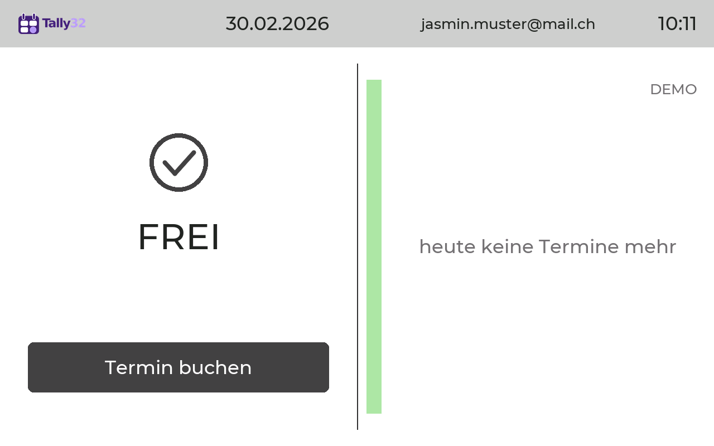

### BESETZT

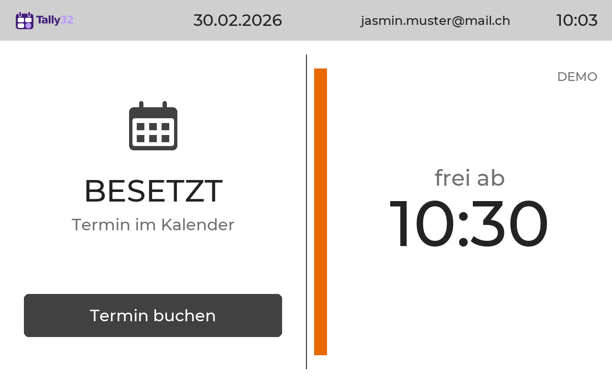

Ein Termin im Kalender läuft (Anzeige "Gebucht" bzw. "Beschäftigt" in Outlook), oder der Teams-Status
steht auf "Nicht stören". Rechts steht, **ab wann** Sie wieder frei sind. Termine mit Lücken bis
5 Minuten gelten als ein durchgehender Block.

### ON AIR (im Gespräch)

Sobald das Mikrofon belegt ist (Teams, 3CX, Zoom, Webex …) oder Teams einen Anruf meldet, erscheint
rechts ein **pulsierendes ON AIR**. Es blendet langsam aus und ein, damit es auffällt. Darunter zeigt
das Display weiter den normalen Zustand mit seinen Zeiten. Besucher sehen so, ob es ein geplanter
Termin ist und wann Sie danach wieder frei sind.

| Gespräch während eines Termins | Spontanes Gespräch |
|---|---|
| 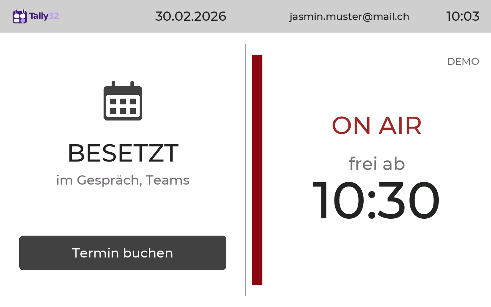 | 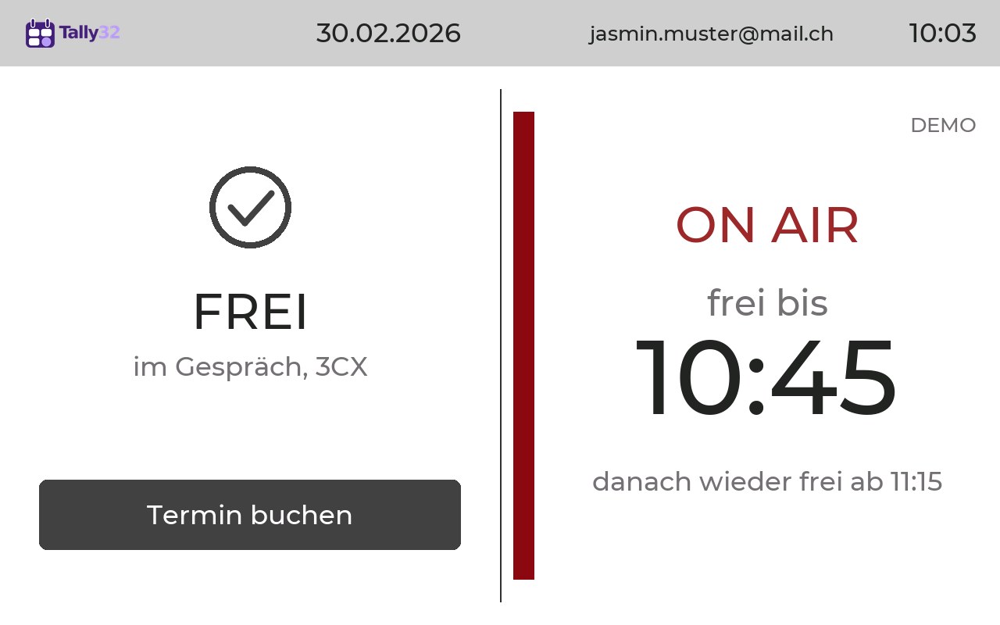 |
| links BESETZT "im Gespräch, Teams", rechts ON AIR über "frei ab" | links FREI "im Gespräch, 3CX", rechts ON AIR über "frei bis" |

Der Balken hat während des Gesprächs die Farbe "Im Gespräch".

### ABWESEND

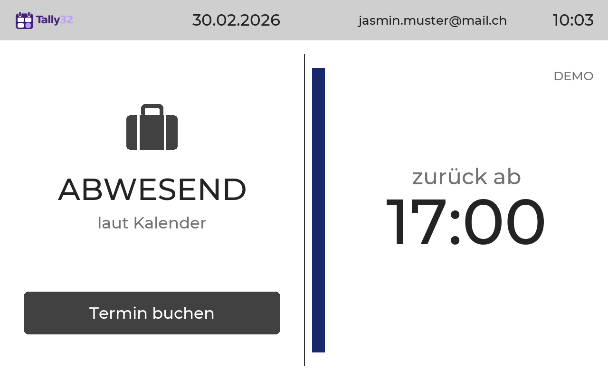

Ein Termin mit "Abwesend" oder "An anderem Ort tätig" läuft, oder Teams steht auf "Abwesend" bzw.
"Gleich zurück". Rechts steht "zurück ab".

### NICHT AM PLATZ

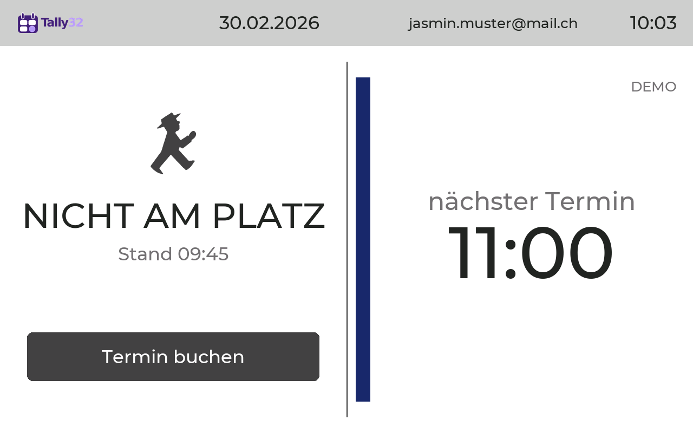

Symbol ist das Ampelmännchen: Sie sind unterwegs. Das Notebook ist abgedockt oder schläft. Das Display rechnet mit den zuletzt erhaltenen Terminen selbst
weiter und zeigt den nächsten Termin. "Stand 09:45" sagt, wann die Daten zuletzt aktualisiert wurden.
Siehe [Ohne Notebook](#8-ohne-notebook-bildschirmschoner-demomodus).

### AUSSER HAUS

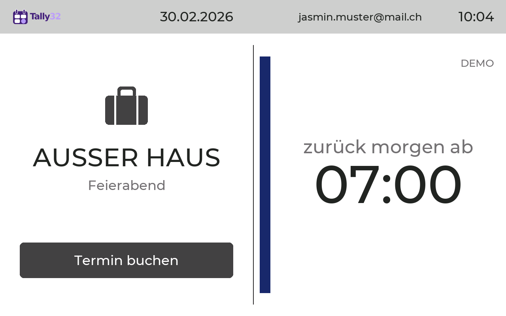

Ausserhalb der Arbeitszeit ("Feierabend" bzw. "Arbeitsfreier Tag") mit dem Zeitpunkt, ab dem Sie zurück
sind. Die Arbeitszeit sind das Zeitfenster und die Wochentage aus den Einstellungen der Terminbuchung.
Nach 2 Minuten ohne Berührung startet der Bildschirmschoner.

### KEIN SIGNAL

Durchgestrichener Kreis: Das Display bekommt keine Daten vom Computer und hat auch keine gültigen
gespeicherten Termine. Siehe [Hilfe bei Problemen](#11-hilfe-bei-problemen).

## 4. Termin buchen (für Besucher)

Ist die Buchung eingeschaltet und der Computer verbunden, steht links der Knopf **Termin buchen**.
Besucher können damit einen Termin in Ihrem Kalender anlegen, in einer freien Zeit der laufenden oder
der kommenden Woche. Gebucht wird immer ein späterer Termin, kein Gespräch "jetzt sofort".

**Schritt 1: E-Mail-Adresse.** An diese Adresse geht die Einladung. Die Tasten ".ch", ".com" und "@"
sparen Tipparbeit. "Weiter" wird erst mit einer gültigen Adresse aktiv.

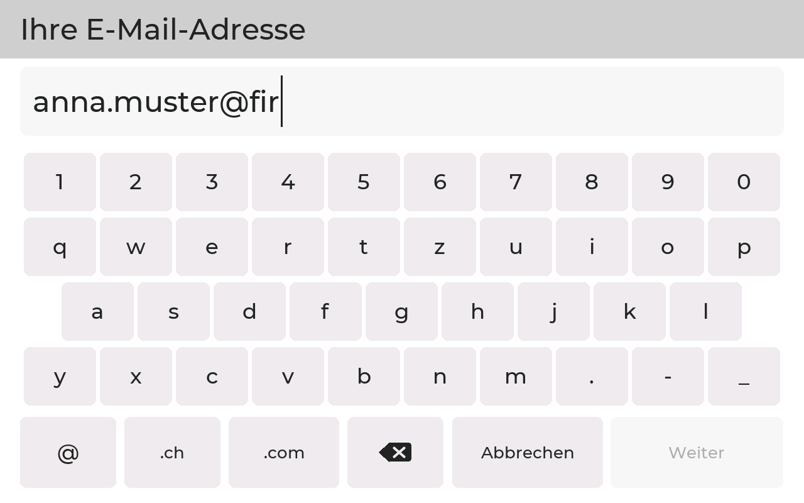

**Schritt 2: Titel des Termins**, zum Beispiel "Projektbesprechung". Mit dem Pfeil links unten
schreiben Sie Grossbuchstaben, die Tastatur hat Umlaute.

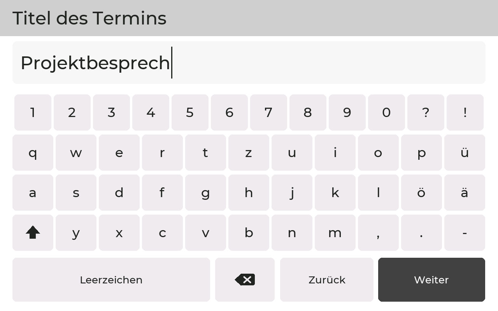

**Schritt 3: Dauer** 15, 30 oder 60 Minuten.

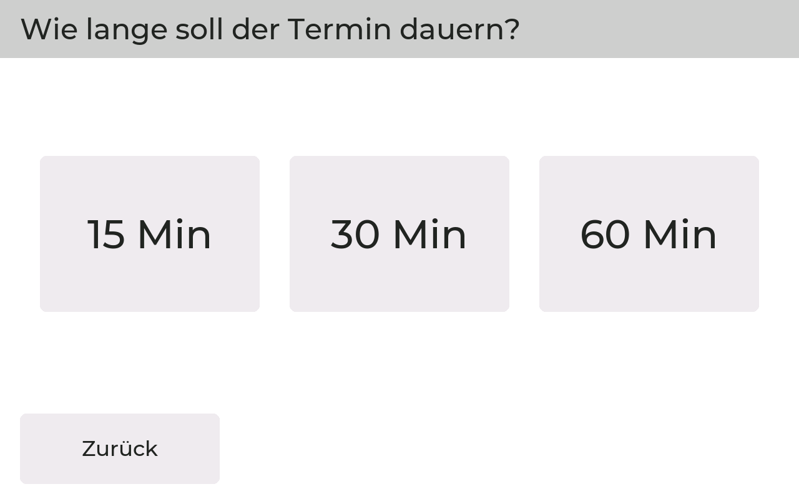

**Schritt 4: Tag.** Oben diese Woche, unten die nächste. Hellgraue Tage sind vergangen oder ganz
belegt, sonst steht die Anzahl freier Zeiten darunter.

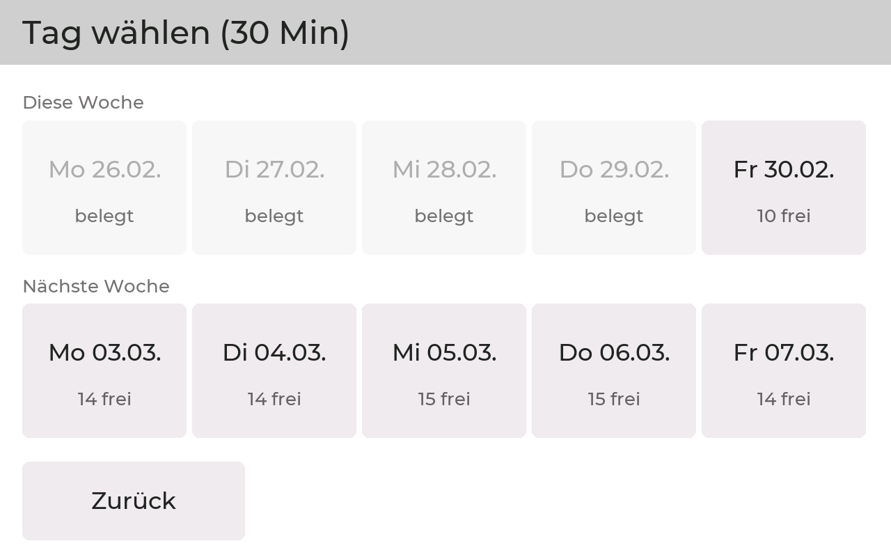

**Schritt 5: Beginn.** Alle freien Startzeiten des Tages, mit "früher" und "später" blättern.

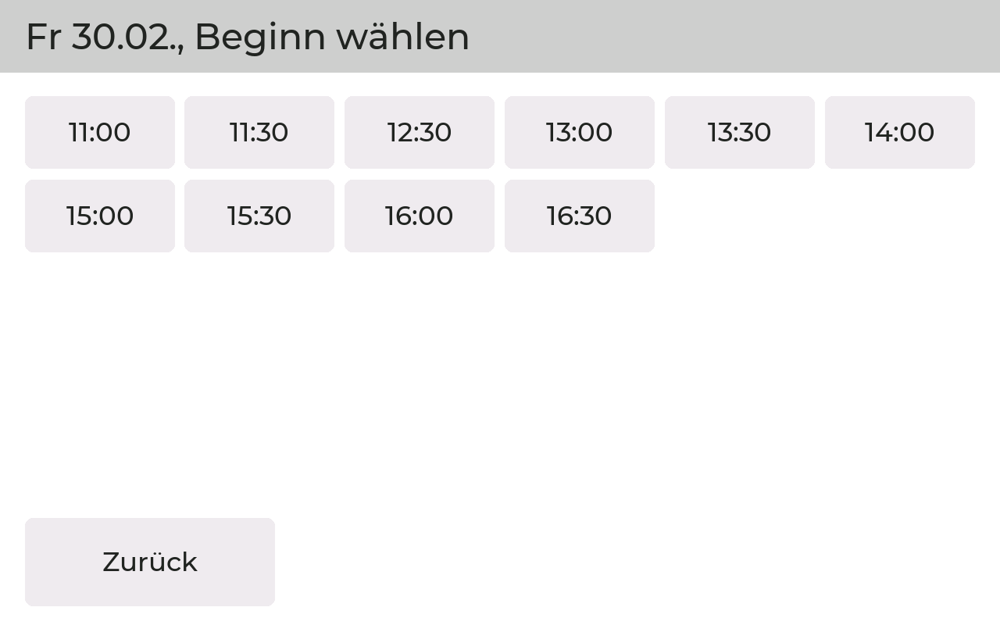

**Schritt 6: Bestätigen.** Zusammenfassung prüfen und "Buchen" antippen.

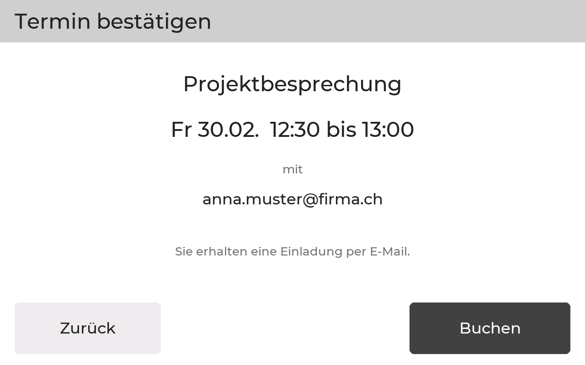

**Schritt 7: Fertig.** Die Einladung geht an die angegebene Adresse, der Termin steht in Ihrem Kalender.
Outlook erinnert Sie sofort an kurzfristig gebuchte Termine.

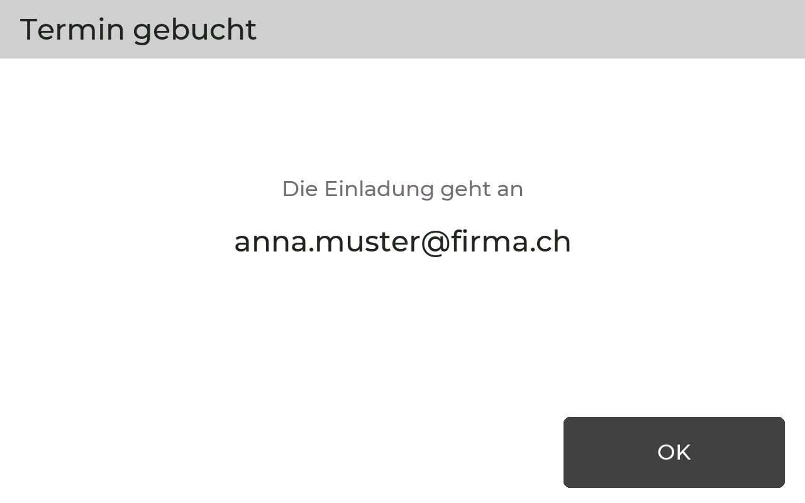

Hinweise:

- Gebucht wird nur innerhalb des eingestellten Zeitfensters, an den gewählten Wochentagen und
  ausserhalb der Mittagspause, frühestens 10 Minuten ab jetzt.
- Als belegt gelten Termine mit "Beschäftigt", "Mit Vorbehalt", "Abwesend" und "An anderem Ort tätig".
- Höchstens 4 Buchungen pro Stunde. Nach 90 Sekunden ohne Berührung bricht der Dialog ab.
- Ohne Verbindung zum Computer ist der Knopf ausgeblendet.

## 5. Inbetriebnahme

### 5.1 Firmware auf das Display spielen

Nur nötig bei einem neuen Display oder nach einem Update. Dafür braucht es PlatformIO (Core ab 6.2).

```bash
cd firmware && pio run -e guition-p4 -t upload --upload-port <port>
```

Für das 10-Zoll-Display `-e guition-p4-10` statt `-e guition-p4`. Der Port heisst am Mac zum
Beispiel `/dev/cu.usbmodem31201`, unter Windows "Serielles USB-Gerät (COM6)". Läuft der Agent schon,
diesen vorher anhalten (er hält den Port offen).

### 5.2 Display anschliessen

Das Display hat hinten zwei USB-C-Buchsen. **Die obere** ist die richtige, an der unteren meldet sich
kein Gerät. Nach dem Einstecken erscheint kurz das Logo, danach KEIN SIGNAL, bis der Agent läuft.

### 5.3 Agent installieren

**Mac** (im Ordner des Repos):

```bash
cd agent && uv venv .venv && uv pip install -p .venv/bin/python -r requirements.txt
```

```bash
agent/install_mac.sh
```

Das Skript richtet den Agenten so ein, dass er bei jeder Anmeldung startet und nach einem Absturz neu
startet. Protokoll: `~/Library/Logs/tally32.log`. Entfernen mit `agent/install_mac.sh uninstall`.

**Windows** (PowerShell im Ordner `agent`):

```
powershell -ExecutionPolicy Bypass -File .\install_windows.ps1
```

Legt die Umgebung an, installiert die Pakete und trägt die Aufgabe "Tally32 Agent" in der
Aufgabenplanung ein (Start bei Anmeldung, unsichtbar). Protokoll:
`%LOCALAPPDATA%\tally32\tally32.log`. Entfernen mit `-Uninstall`.

Der Agent findet das Display von selbst. Das Verbindungssymbol oben rechts zeigt dann eine
geschlossene Linie.

### 5.4 Bei Microsoft 365 anmelden

Am einfachsten am Display: Menü öffnen (siehe [Abschnitt 6](#6-einstellungen-am-display)),
**Microsoft 365** und **Neues Konto verbinden** antippen. Das Display zeigt eine Adresse und einen
Code. Diese Adresse am Computer oder Handy öffnen, den Code eingeben und mit dem eigenen Konto
anmelden. Alternativ am Computer:

```bash
agent/.venv/bin/python agent/tally_agent.py login
```

Wichtig:

- Das Konto braucht ein Exchange-Postfach. Konten ohne Postfach lehnt der Agent ab.
- Für die Terminbuchung vorher in `~/.config/tally32/config.json` (Windows:
  `%USERPROFILE%\.config\tally32\config.json`) `"booking": true` setzen und dann anmelden.
- Je nach Firma muss die IT die Rechte einmal freigeben: `Calendars.ReadBasic`, `Presence.Read` und für
  die Buchung `Calendars.ReadWrite`. Ohne Freigabe ohne PowerShell: einmal mit dem Admin-Konto anmelden,
  "Consent on behalf of your organization" anhaken, die Ablehnung des Admin-Kontos abwarten und dann mit
  dem eigenen Konto anmelden.
- Der Anmeldeschlüssel liegt verschlüsselt im Schlüsselbund (Mac) bzw. per DPAPI (Windows).

### 5.5 Weitere Einstellungen des Agenten

In `config.json`:

| Einstellung | Bedeutung |
|---|---|
| `"booking": true` | Terminbuchung am Display erlauben |
| `"presence": false` | Teams-Status nicht abfragen, nur Kalender |
| `"teams_away": false` | Teams "Abwesend" nicht als ABWESEND anzeigen |
| `"busy_show_as": ["busy", "tentative"]` | auch Termine "Mit Vorbehalt" als besetzt zählen |
| `"merge_gap_min": 5` | Lücken bis zu so vielen Minuten gelten als durchgehend besetzt |
| `"mic_ignore": [...]` | Programme, die nie ON AIR auslösen sollen |
| `"port": "sn:<nummer>"` | ein bestimmtes Display wählen, siehe [Abschnitt 9](#9-zwei-displays-an-einem-computer) |

Nach einer Änderung den Agenten neu starten (`agent/install_mac.sh` nochmals ausführen bzw. unter
Windows abmelden und wieder anmelden).

## 6. Einstellungen am Display

**3 Sekunden auf das Tally32-Logo oben links drücken**, dann den PIN eingeben. Ab Werk ist der PIN
`0000`, bitte unter "PIN ändern" ersetzen. Nach 5 falschen Versuchen ist das Menü eine Minute gesperrt,
nach 60 Sekunden ohne Berührung schliesst es sich von selbst.

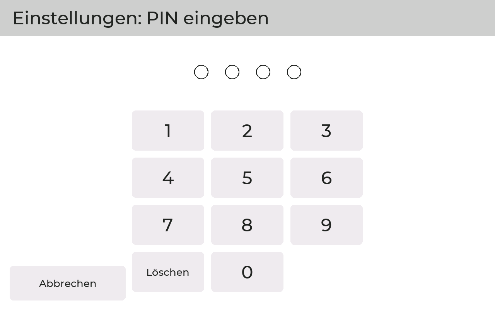

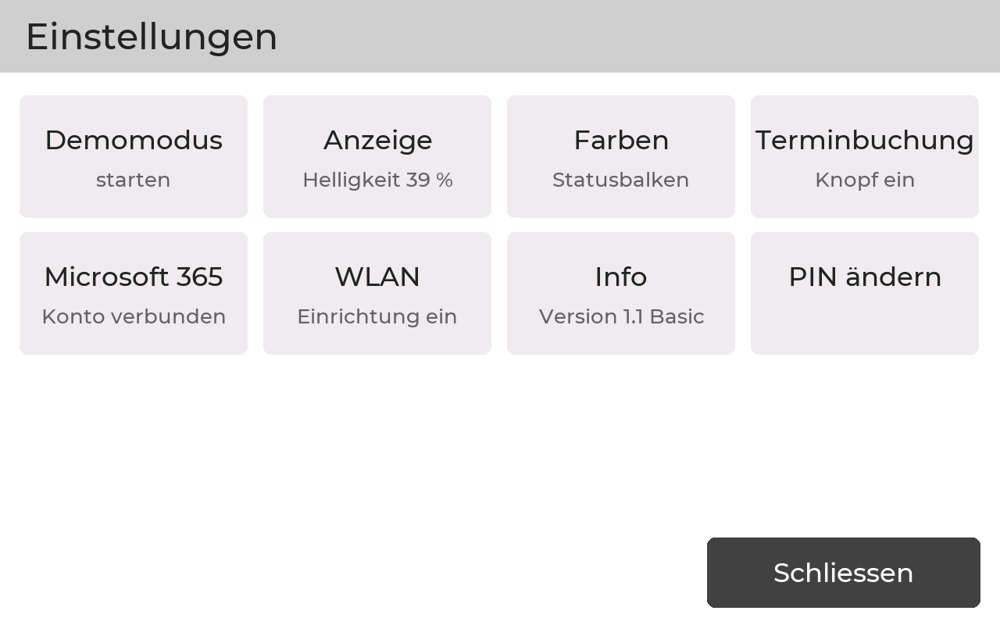

| Kachel | Inhalt |
|---|---|
| Demomodus | alle Zustände der Reihe nach vorführen, siehe [Abschnitt 8](#8-ohne-notebook-bildschirmschoner-demomodus) |
| Anzeige | Helligkeit, Display um 180 Grad drehen, Name in der Kopfzeile |
| Farben | Farbe des Balkens je Zustand |
| Terminbuchung | Knopf ein oder aus, Zeitfenster, Wochentage, Mittagspause |
| Microsoft 365 | angemeldetes Konto, neues Konto verbinden |
| WLAN | Einrichtungs-WLAN für das Webinterface ein oder aus |
| Info | Version, Display, Verbindung, Konto, Einrichtungs-WLAN, Uhr, letzter Neustart |
| PIN ändern | neuen PIN zweimal eingeben |

### Anzeige

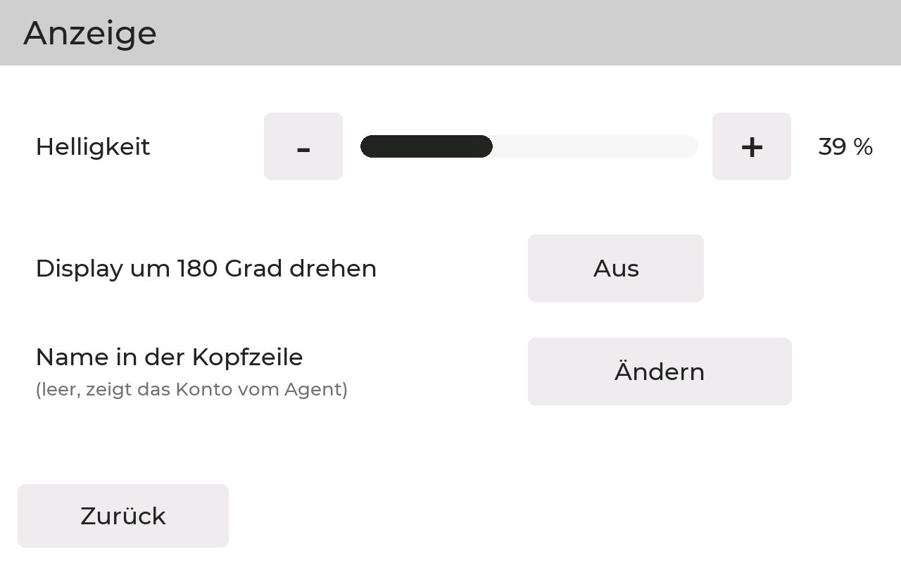

- **Helligkeit** mit Minus und Plus.
- **Display um 180 Grad drehen**, zum Beispiel wenn das Kabel oben besser passt.
- **Name in der Kopfzeile:** Ist er leer, steht dort das angemeldete Microsoft-Konto. Mit "Ändern"
  einen eigenen Namen eintippen, zum Beispiel "Jasmin Muster".

### Farben

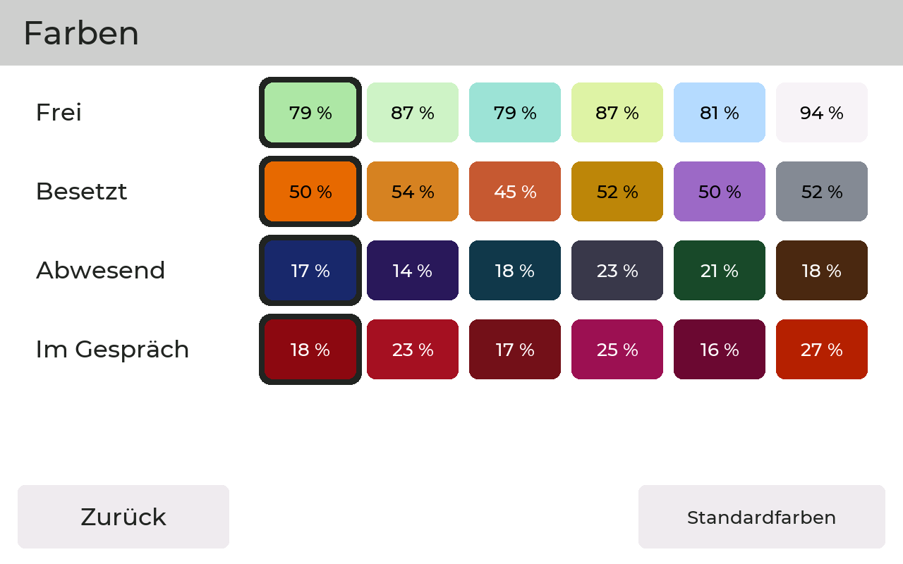

Sechs Vorschläge je Zustand, jeweils mit dem Helligkeitswert in Prozent. Wählen Sie die Farben so, dass
sich die Zustände auch in der Helligkeit deutlich unterscheiden. "Standardfarben" stellt den
Auslieferungszustand wieder her.

### Terminbuchung

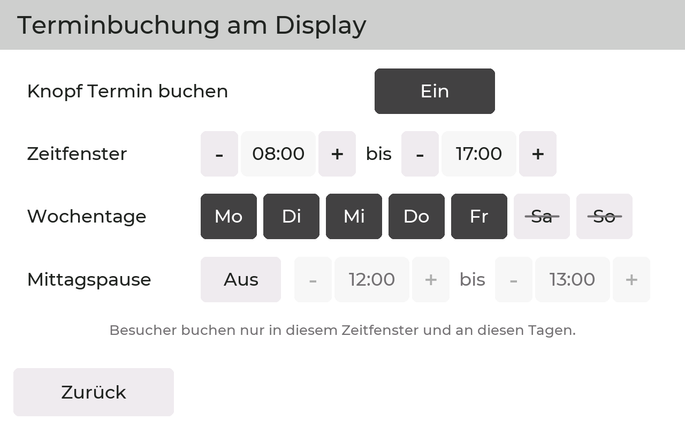

- **Knopf Termin buchen** ein oder aus.
- **Zeitfenster:** frühester Beginn und spätestes Ende, in Viertelstunden. Gilt zugleich als
  Arbeitszeit für AUSSER HAUS.
- **Wochentage:** dunkel = gebucht werden kann, durchgestrichen = nicht.
- **Mittagspause:** ein oder aus, mit Beginn und Ende.

### Microsoft 365

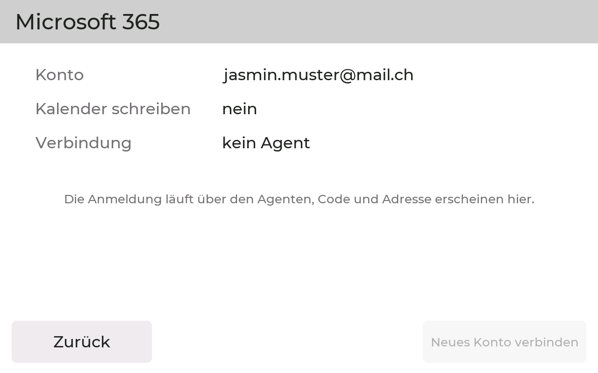

Zeigt das angemeldete Konto, ob der Agent in den Kalender schreiben darf ("Kalender schreiben", nötig
für die Buchung) und ob der Agent verbunden ist. "Neues Konto verbinden" startet die Anmeldung wie in
[Abschnitt 5.4](#54-bei-microsoft-365-anmelden) und ersetzt das bisherige Konto.

### WLAN (Einrichtungs-WLAN)

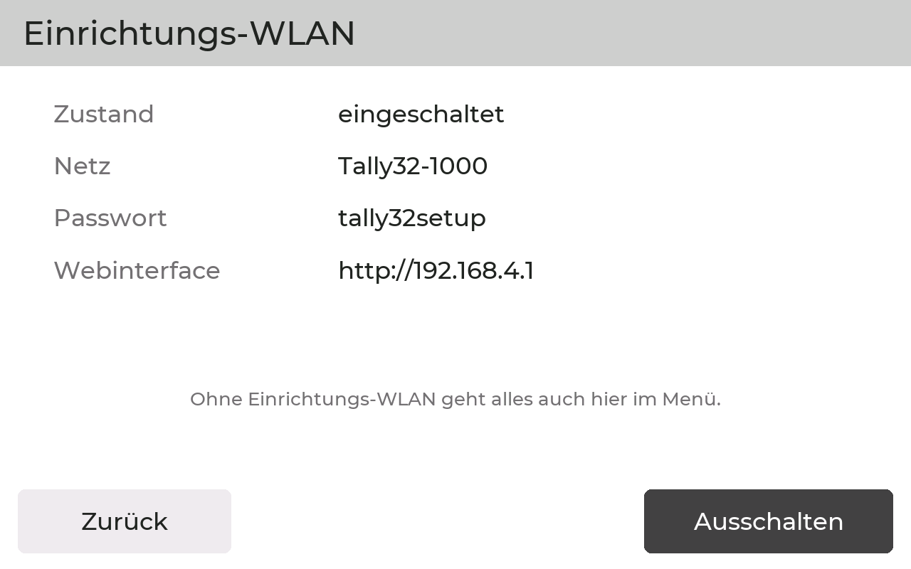

Das Display kann ein eigenes kleines WLAN aufspannen, über das das Webinterface erreichbar ist. Es
hat keinen Internetzugang und dient nur der Einrichtung. Hier sehen Sie Netzname, Passwort und Adresse
und schalten es ein oder aus. Im Alltag darf es aus bleiben, alles geht auch im Menü.

### Info

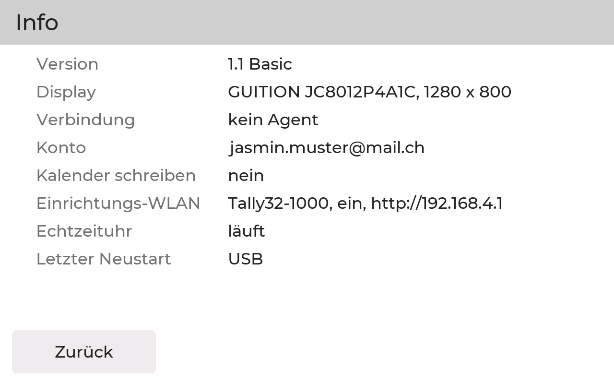

Version der Firmware, Displaytyp, Verbindung zum Agenten, Konto, ob das Schreiben in den Kalender
erlaubt ist, Einrichtungs-WLAN (Name, ein oder aus und Adresse des Webinterface), Zustand der Uhr
und der Grund des letzten Neustarts. Bei Fragen an den Support bitte ein Foto dieser Seite schicken.

## 7. Webinterface

Ist das Einrichtungs-WLAN eingeschaltet, verbinden Sie ein Handy oder Tablet mit dem WLAN
`Tally32-XXXX` (Passwort ab Werk `tally32setup`) und öffnen **http://192.168.4.1**.

| | Benutzer | Passwort |
|---|---|---|
| WLAN `Tally32-XXXX` | | `tally32setup` |
| Webinterface | `admin` | `tally32`, muss beim ersten Anmelden geändert werden |

Dort finden Sie dieselben Einstellungen wie im Menü und zusätzlich: Passwort des WLAN und des
Webinterface ändern, Microsoft-365-Anmeldung starten (Adresse und Code erscheinen im Webinterface und
auf dem Display), Demomodus.

Wieder einschalten lässt sich ein abgeschaltetes Einrichtungs-WLAN nur am Gerät: im Menü oder
**5 Sekunden auf das Display drücken**.

## 8. Ohne Notebook, Bildschirmschoner, Demomodus

### Ohne Notebook (abgedockt)

Der Agent schickt alle 30 Sekunden die Uhrzeit und die Termine von heute und morgen ans Display. Ist das
Notebook weg oder schläft es, rechnet das Display damit selbst weiter: in einem Termin BESETZT mit
"zurück ca." bzw. ABWESEND, sonst NICHT AM PLATZ mit dem nächsten Termin, immer mit "Stand HH:MM".
Die Daten gelten höchstens 16 Stunden. Der Knopf "Termin buchen" ist ohne Notebook ausgeblendet.

Manche Dockingstationen schalten beim Abdocken kurz den Strom ab, das Display startet dann neu. Die
Termine sind gespeichert, die Uhrzeit hält die Knopfzelle. Ob die Uhr läuft, steht im Menü unter Info
("Echtzeituhr").

### Bildschirmschoner

Ist der Computer 5 Minuten gesperrt, oder ist ausserhalb der Arbeitszeit 2 Minuten niemand am Display,
startet der Bildschirmschoner: dunkler Grund, das Logo wandert langsam, "Tap Me" springt alle
30 Sekunden weiter. Antippen zeigt wieder die normale Anzeige (der Tipp löst sonst nichts aus).
Entsperren des Computers beendet den Schoner sofort.

### Demomodus

Im Menü oder im Webinterface ein- und ausschalten. Das Display zeigt dann reihum alle Zustände, alle
6 Sekunden einen neuen, und führt einmal pro Runde eine Buchung vor. Besucher können "Termin buchen"
selbst ausprobieren, die freien Zeiten sind erfunden und gebucht wird nichts. Oben rechts steht "DEMO".
Der Demomodus bleibt über einen Neustart eingeschaltet.

## 9. Zwei Displays an einem Computer

Für jedes Display läuft ein eigener Agent, der sein Display an der USB-Seriennummer erkennt. Die Nummern
zeigt:

```bash
agent/.venv/bin/python -m serial.tools.list_ports -v
```

Beim Display steht `SER=12:34:56:...`. Das erste Display tragen Sie in `config.json` als
`"port": "sn:<nummer>"` ein, für das zweite richten Sie am Mac einen weiteren Agenten ein:

```bash
agent/install_mac.sh display 2 sn:12:34:56:78:9A:BC
```

Protokoll: `~/Library/Logs/tally32-2.log`, entfernen mit `agent/install_mac.sh uninstall 2`. Beide
Displays zeigen dasselbe Konto. Mit `"port": "auto"` würden sich zwei Agenten dasselbe Display nehmen.

## 10. Datenschutz

- Der Agent liest aus dem Kalender nur Beginn, Ende und Art eines Termins ("Beschäftigt",
  "Abwesend" …), **nie Betreff, Teilnehmer oder Inhalt**. Das Display zeigt nur Zeiten.
- Vom Mikrofon erkennt der Agent nur, **ob** es belegt ist und von welchem Programm. Es wird nichts
  aufgenommen.
- Die eingebaute Kamera des Displays wird nicht verwendet.
- Am Computer meldet sich das Display nur als serielle Schnittstelle (COM-Port), nie als Tastatur oder Speicher.
- Bei einer Buchung gibt der Besucher seine E-Mail-Adresse ein, sie geht nur in die Einladung.

## 11. Hilfe bei Problemen

| Problem | Lösung |
|---|---|
| KEIN SIGNAL | Läuft der Agent? Steckt das Kabel in der **oberen** Buchse? Ist es ein Datenkabel? Protokoll des Agenten prüfen |
| Display erscheint nicht am Computer | fast immer ein reines Ladekabel, anderes Kabel nehmen |
| Kein Knopf "Termin buchen" | Menü > Terminbuchung > Knopf "Ein", Agent verbunden? In `config.json` `"booking": true` und neu anmelden |
| Nach einem Stromunterbruch KEIN SIGNAL | Knopfzelle CR1220 fehlt oder ist leer, Menü > Info > Echtzeituhr |
| Kein Datum in der Kopfzeile | Das Display hat noch keine Uhrzeit vom Agenten (10 Zoll: ohne Knopfzelle nach jedem Neustart) |
| Teams-Status fehlt | Konto braucht ein Arbeits- oder Schulkonto mit Freigabe `Presence.Read` |
| PIN oder Passwort vergessen | **10 Sekunden** auf das Display drücken: Passwörter und PIN gelten wieder ab Werk |
| 10 Zoll: Touch reagiert nicht | Strom ganz unterbrechen, also USB **und** Akku abziehen, dann wieder anstecken |
| Telefon am Tisch löst kein ON AIR aus | ein Tischtelefon belegt kein Mikrofon am Computer, das erkennt Tally32 nicht |

## 12. Lizenz

Tally32 Basic steht unter der **PolyForm Noncommercial License 1.0.0** ([LICENSE.md](../LICENSE.md)).
Erlaubt ist die Nutzung für nicht kommerzielle Zwecke: privat sowie durch gemeinnützige Organisationen,
Bildungs- und Forschungseinrichtungen und öffentliche Stellen. **Jede kommerzielle Nutzung**, auch in
Teilen, etwa der Einsatz in einem Unternehmen, **braucht eine kommerzielle Lizenz**. Kontakt: Oliver Timme,
hello@timme-security.ch. Bestandteile Dritter und ihre Lizenzen stehen in [NOTICE.txt](../NOTICE.txt).
