*Deutsche Version: [Anleitung.md](Anleitung.md)*

# Tally32 Basic: User Manual

Tally32 shows at your desk whether you are on a call, in a meeting or free, and above all
**when you will be free again**. Visitors see this at a glance and can book a meeting with you
directly on the display if needed.

Tally32 Basic consists of one display per desk and a small program on your computer, the
**agent**. The agent reads your Outlook calendar, your Teams presence and the microphone and sends
the status to the display over a USB cable. No company network and no server are needed.

All pictures in this manual come straight from the device (10 inch display, demo mode, sample
account jasmin.muster@mail.ch). The date 30.02.2026 in the header does not exist. It marks the
pictures as demo pictures. The 7 inch display looks exactly the same, only smaller.

## Contents

1. [What you need](#1-what-you-need)
2. [The display at a glance](#2-the-display-at-a-glance)
3. [The states](#3-the-states)
4. [Book a meeting (for visitors)](#4-book-a-meeting-for-visitors)
5. [Setup](#5-setup)
6. [Settings on the display](#6-settings-on-the-display)
7. [Web interface](#7-web-interface)
8. [Without notebook, screen saver, demo mode](#8-without-notebook-screen-saver-demo-mode)
9. [Two displays on one computer](#9-two-displays-on-one-computer)
10. [Privacy](#10-privacy)
11. [Troubleshooting](#11-troubleshooting)
12. [Licence](#12-licence)

## 1. What you need

| Part | Note |
|---|---|
| Display GUITION JC1060P470C (7 inch, 1024 x 600) or GUITION JC8012P4A1C (10.1 inch, 1280 x 800) | both with ESP32-P4 and touch, about 50 or 60 Swiss francs. Sources: [7 inch](https://de.aliexpress.com/item/1005010023056143.html), [10.1 inch](https://de.aliexpress.com/item/1005009147577522.html) (AliExpress) |
| USB-C cable with data lines | a charge-only cable does not work, the display then does not show up on the computer |
| CR1220 coin cell (7 inch) | keeps the time during a power cut. Without it the display shows NO SIGNAL afterwards until the computer is connected again |
| Computer with macOS (14.2 or later) or Windows 11 | the agent runs there |
| Microsoft 365 account with an Exchange mailbox | for calendar, Teams presence and meeting booking. Without an account Tally32 only detects calls through the microphone |

Connect the display to the docking station or to its own USB power supply, not directly to the
notebook. Otherwise it turns off when you undock.

## 2. The display at a glance


| Area | Content |
|---|---|
| **Header** (light grey) | on the left the Tally32 logo, then the date, the name (or the signed-in account) and on the right the time |
| **Left area** | symbol and state in large letters, below it the source (for example "per calendar"). At the bottom the **Book a meeting** button if booking is turned on |
| **Centre line** | thin dark line with a narrow **bar in the colour of the state** next to it |
| **Right area** | the most important time, for example "free until 10:45", with additional information below. At the top right the symbol for the connection to the computer |

Every state can be recognised by its text and symbol. The colour of the bar is only an addition.
The colours also differ clearly in brightness (free light, busy medium, call and away dark). This
keeps the display unambiguous for colour blind people as well.

**Connection symbol at the top right:** solid line = computer connected, broken line = no
connection. In demo mode it shows "DEMO".

## 3. The states

### FREE


No meeting and no call. On the right you see **until when** you are free (start of the next
meeting), below it "free again from" with the end of that meeting. If there are no more meetings,
it says "no more appointments today":

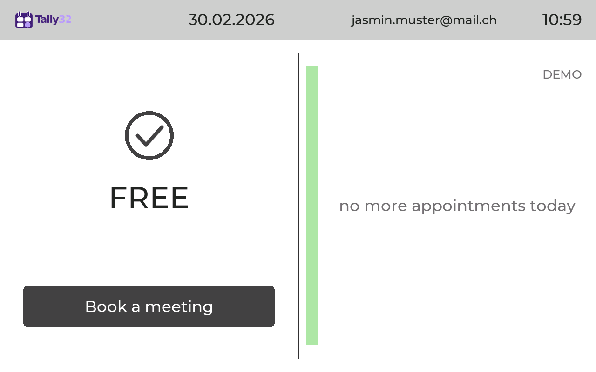

### BUSY


A calendar meeting is running (shown as "Busy" in Outlook), or the Teams presence is set to
"Do not disturb". On the right you see **from when** you are free again. Meetings with gaps of up
to 5 minutes count as one continuous block.

### ON AIR (on a call)

As soon as the microphone is in use (Teams, 3CX, Zoom, Webex …) or Teams reports a call, a
**pulsing ON AIR** appears on the right. It slowly fades out and in so that it catches the eye.
Below it the display keeps showing the normal state with its times. Visitors can see whether it is
a planned meeting and when you will be free afterwards.

| Call during a meeting | Spontaneous call |
|---|---|
|  |  |
| left BUSY "on a call, Teams", right ON AIR above "free from" | left FREE "on a call, 3CX", right ON AIR above "free until" |

During the call the bar has the colour "On a call".

### AWAY


A meeting marked "Out of office" or "Working elsewhere" is running, or Teams is set to "Away" or
"Be right back". On the right it says "back at".

### NOT AT DESK


The symbol is the walking traffic light man: you are on the move. The notebook is undocked or
asleep. The display keeps working with the meetings it received last and shows the next
appointment. "as of 09:45" tells you when the data was last updated. See
[Without notebook](#8-without-notebook-screen-saver-demo-mode).

### OUT OF OFFICE


Outside working hours ("After hours" or "Day off") with the time from which you are back. Working
hours are the time window and the weekdays from the meeting booking settings. After 2 minutes
without a touch the screen saver starts.

### NO SIGNAL

Crossed out circle: the display receives no data from the computer and has no valid stored
meetings either. See [Troubleshooting](#11-troubleshooting).

## 4. Book a meeting (for visitors)

If booking is turned on and the computer is connected, the **Book a meeting** button appears on
the left. Visitors can use it to add a meeting to your calendar, in a free slot of the current or
the next week. A booking is always for a later time, never a call "right now".

**Step 1: email address.** The invitation goes to this address. The keys ".ch", ".com" and "@"
save typing. "Next" only becomes active with a valid address.

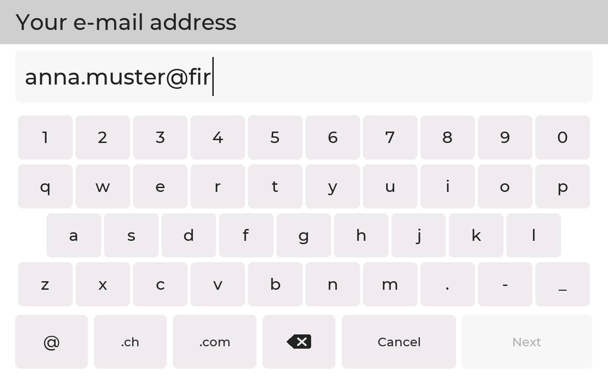

**Step 2: title of the meeting**, for example "Project meeting". The arrow at the bottom left
switches to capital letters. The keyboard has umlauts.

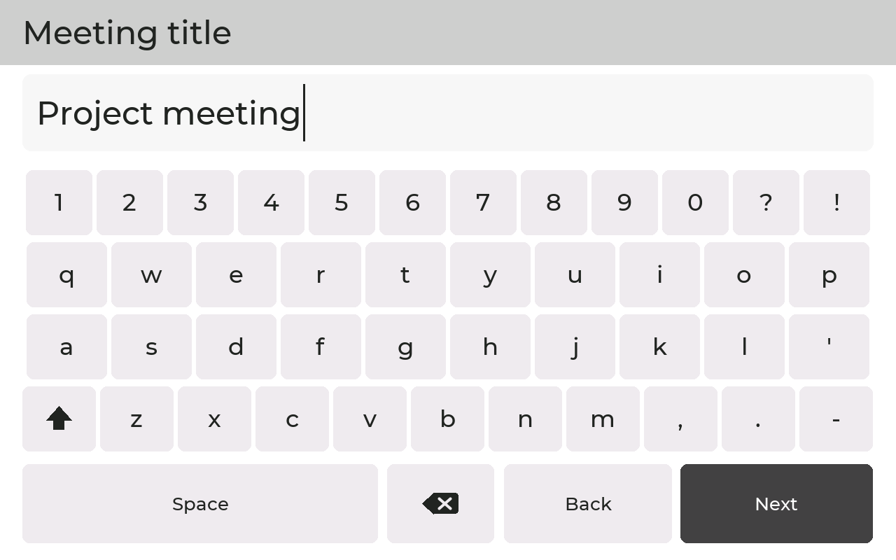

**Step 3: duration** 15, 30 or 60 minutes.

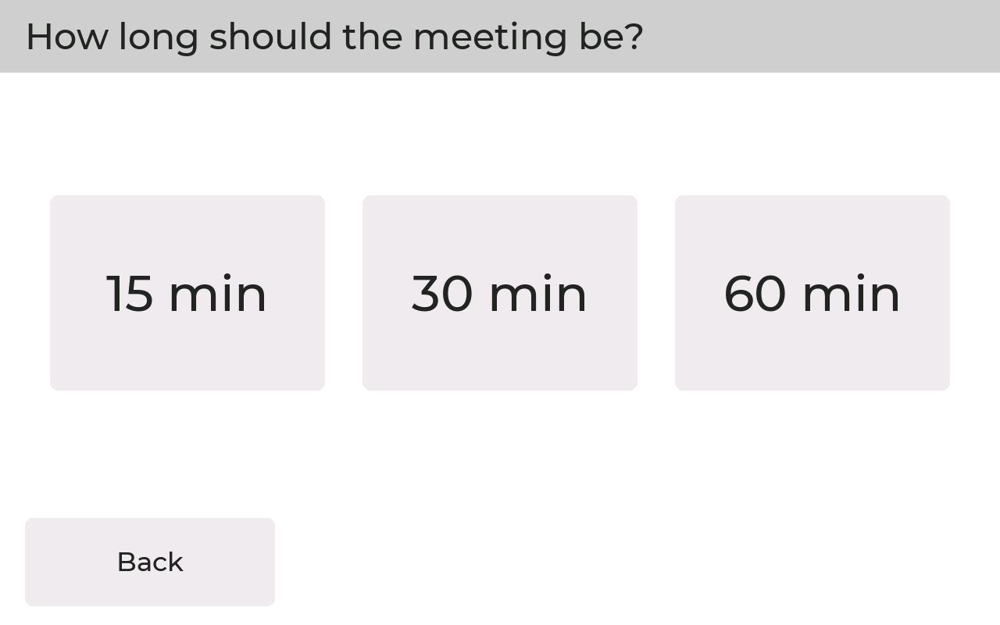

**Step 4: day.** This week at the top, next week at the bottom. Light grey days are in the past or
fully booked. Otherwise the number of free slots is shown below the day.

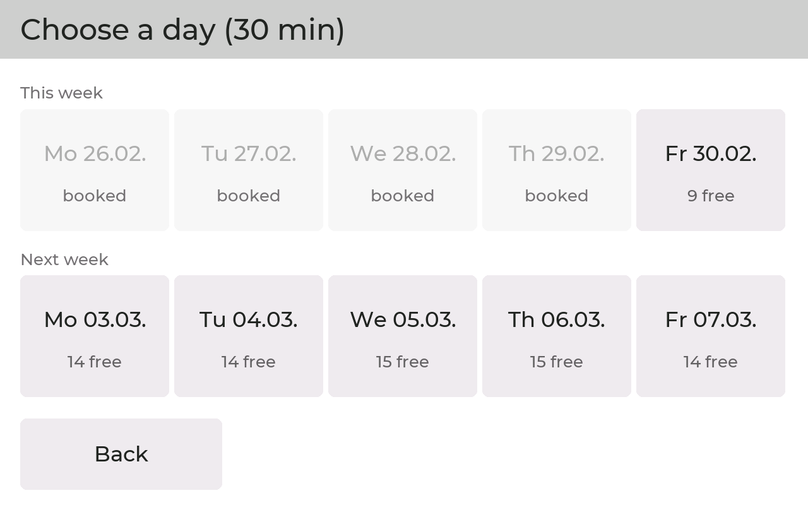

**Step 5: start time.** All free start times of the day. Use "earlier" and "later" to page.


**Step 6: confirm.** Check the summary and tap "Book".

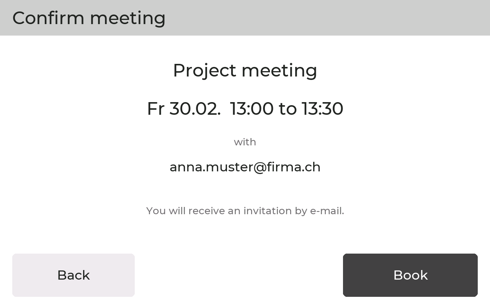

**Step 7: done.** The invitation goes to the address entered and the meeting is in your calendar.
Outlook reminds you immediately of meetings booked at short notice.

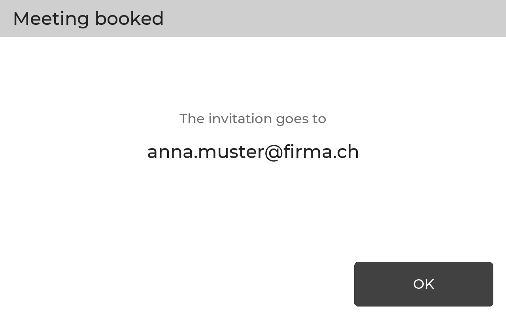

Notes:

- Bookings are only possible within the configured time window, on the selected weekdays and
  outside the lunch break, at the earliest 10 minutes from now.
- Meetings marked "Busy", "Tentative", "Out of office" and "Working elsewhere" count as taken.
- At most 4 bookings per hour. After 90 seconds without a touch the dialog is cancelled.
- Without a connection to the computer the button is hidden.

## 5. Setup

### 5.1 Flash the firmware onto the display

Only needed for a new display or after an update. This requires PlatformIO (Core 6.2 or later).

```bash
cd firmware && pio run -e guition-p4 -t upload --upload-port <port>
```

For the 10 inch display use `-e guition-p4-10` instead of `-e guition-p4`. On a Mac the port is
called something like `/dev/cu.usbmodem31201`, on Windows "USB Serial Device (COM6)". If the agent
is already running, stop it first (it keeps the port open).

### 5.2 Connect the display

The display has two USB-C sockets on the back. **The upper one** is the right one. Nothing shows
up on the lower one. After plugging in, the logo appears briefly, then NO SIGNAL until the agent
is running.

### 5.3 Install the agent

**Mac** (in the repository folder):

```bash
cd agent && uv venv .venv && uv pip install -p .venv/bin/python -r requirements.txt
```

```bash
agent/install_mac.sh
```

The script sets up the agent so that it starts at every login and restarts after a crash. Log:
`~/Library/Logs/tally32.log`. Remove it with `agent/install_mac.sh uninstall`.

**Windows** (PowerShell in the `agent` folder):

```
powershell -ExecutionPolicy Bypass -File .\install_windows.ps1
```

This creates the environment, installs the packages and adds the task "Tally32 Agent" to the Task
Scheduler (starts at login, hidden). Log: `%LOCALAPPDATA%\tally32\tally32.log`. Remove it with
`-Uninstall`.

The agent finds the display by itself. The connection symbol at the top right then shows a solid
line.

### 5.4 Sign in to Microsoft 365

The easiest way is on the display: open the menu (see [section 6](#6-settings-on-the-display)),
tap **Microsoft 365** and **Connect new account**. The display shows an address and a code. Open
this address on your computer or phone, enter the code and sign in with your own account.
Alternatively on the computer:

```bash
agent/.venv/bin/python agent/tally_agent.py login
```

Important:

- The account needs an Exchange mailbox. The agent rejects accounts without a mailbox.
- For meeting booking, first set `"booking": true` in `~/.config/tally32/config.json` (Windows:
  `%USERPROFILE%\.config\tally32\config.json`) and then sign in.
- Depending on the company, IT has to approve the permissions once: `Calendars.ReadBasic`,
  `Presence.Read` and for booking `Calendars.ReadWrite`. Approval without PowerShell: sign in once
  with the admin account, tick "Consent on behalf of your organization", wait until the agent
  rejects the admin account and then sign in with your own account.
- The sign-in token is stored encrypted in the Keychain (Mac) or with DPAPI (Windows).

### 5.5 Further agent settings

In `config.json`:

| Setting | Meaning |
|---|---|
| `"booking": true` | allow meeting booking on the display |
| `"presence": false` | do not query the Teams presence, calendar only |
| `"teams_away": false` | do not show Teams "Away" as AWAY |
| `"busy_show_as": ["busy", "tentative"]` | also count "Tentative" meetings as busy |
| `"merge_gap_min": 5` | gaps of up to this many minutes count as continuously busy |
| `"mic_ignore": [...]` | programs that should never trigger ON AIR |
| `"port": "sn:<number>"` | select a specific display, see [section 9](#9-two-displays-on-one-computer) |

After a change restart the agent (run `agent/install_mac.sh` again, or on Windows sign out and
sign in again).

## 6. Settings on the display

**Press and hold the Tally32 logo at the top left for 3 seconds**, then enter the PIN. The factory
PIN is `0000`. Please change it under "Change PIN". After 5 wrong attempts the menu is locked for
one minute. After 60 seconds without a touch it closes by itself.

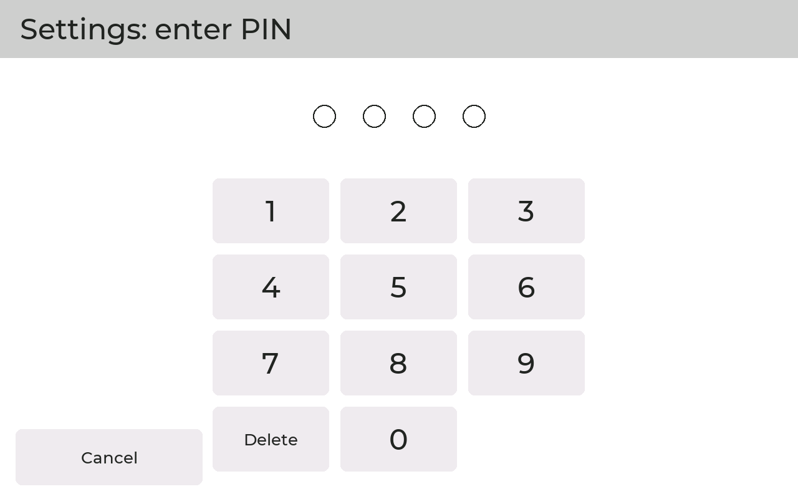

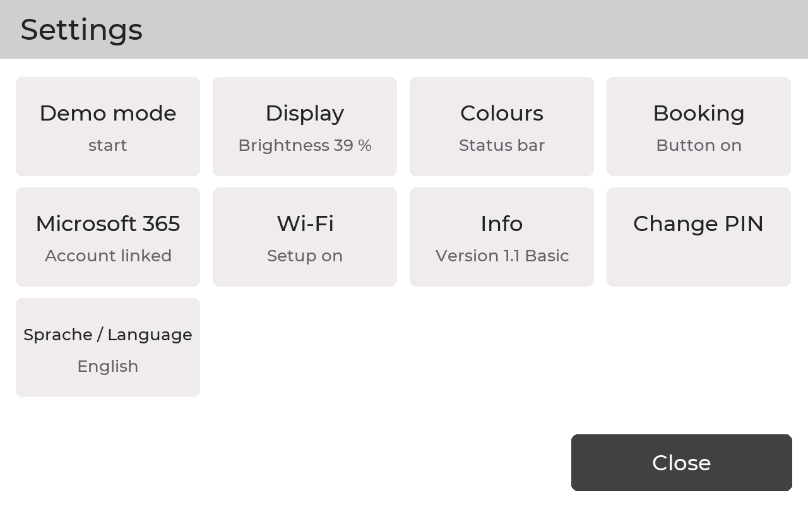

| Tile | Content |
|---|---|
| Demo mode | show all states one after the other, see [section 8](#8-without-notebook-screen-saver-demo-mode) |
| Display | brightness, rotate display by 180 degrees, name in the header |
| Sprache / Language | Deutsch or English for the display, the web interface and the texts sent by the agent |
| Colours | colour of the bar per state |
| Meeting booking | button on or off, time window, weekdays, lunch break |
| Microsoft 365 | signed-in account, connect new account |
| Wi-Fi | setup Wi-Fi for the web interface on or off |
| Info | version, display, connection, account, setup Wi-Fi, clock, last restart |
| Change PIN | enter the new PIN twice |

### Display

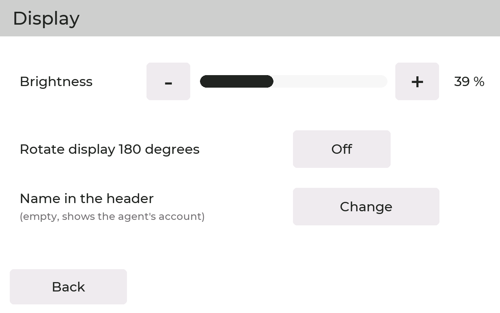

- **Brightness** with minus and plus.
- **Rotate display by 180 degrees**, for example if the cable fits better at the top.
- **Name in the header:** if it is empty, the signed-in Microsoft account is shown. Use "Change" to
  type your own name, for example "Jasmin Muster".

### Sprache / Language

Choose **Deutsch** or **English**. The language applies to the display, the web interface and the
texts the agent sends to the display (for example the source "per calendar"). The setting is kept
after a restart. The tile has the same bilingual name in both languages, so you can always find it.

### Colours

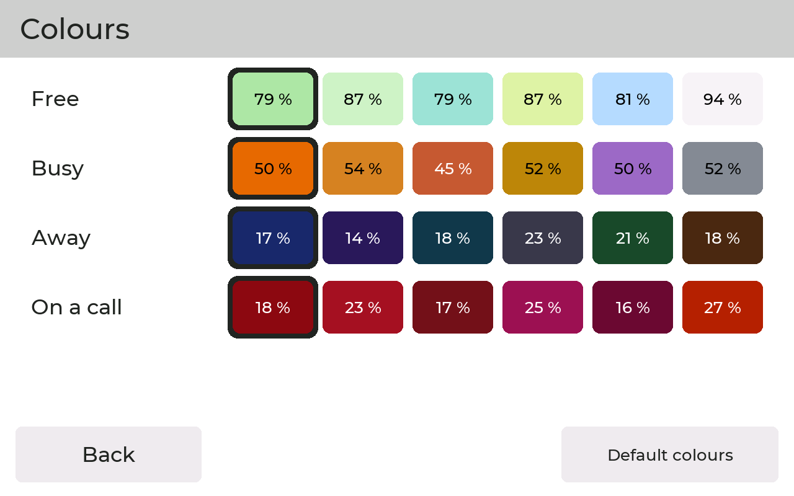

Six suggestions per state, each with its brightness value in percent. Choose the colours so that
the states also differ clearly in brightness. "Default colours" restores the factory settings.

### Meeting booking

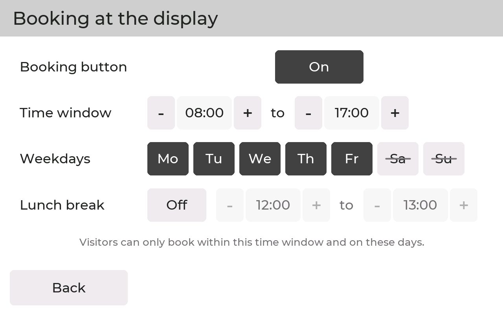

- **Book a meeting button** on or off.
- **Time window:** earliest start and latest end, in quarter hours. This is also the working time
  for OUT OF OFFICE.
- **Weekdays:** dark = bookable, crossed out = not bookable.
- **Lunch break:** on or off, with start and end.

### Microsoft 365

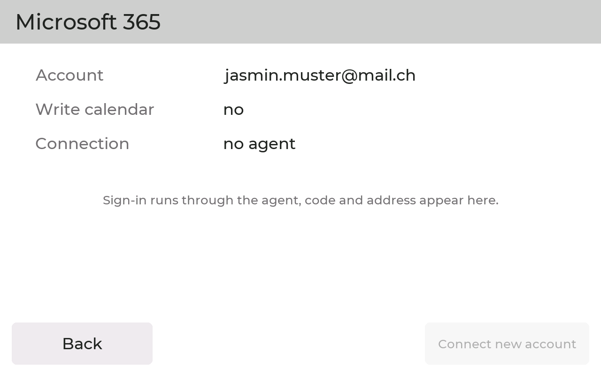

Shows the signed-in account, whether the agent may write to the calendar ("Write calendar", needed
for booking) and whether the agent is connected. "Connect new account" starts the sign-in as in
[section 5.4](#54-sign-in-to-microsoft-365) and replaces the previous account.

### Wi-Fi (setup Wi-Fi)

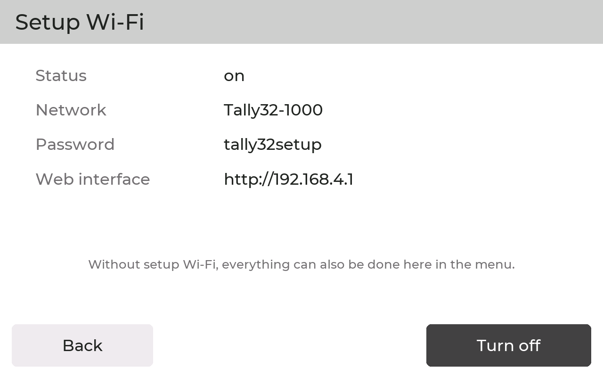

The display can open its own small Wi-Fi network through which the web interface can be reached.
It has no internet access and is only meant for setup. Here you see the network name, password and
address and can turn it on or off. In daily use it can stay off, everything is also possible in
the menu.

### Info

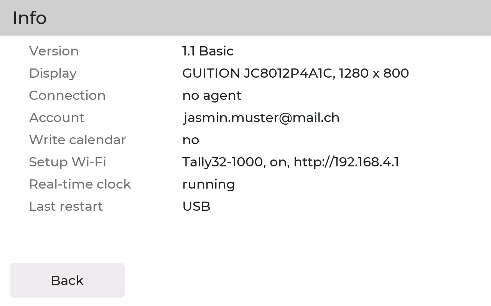

Firmware version, display type, connection to the agent, account, whether writing to the calendar
is allowed, setup Wi-Fi (name, on or off and address of the web interface), state of the clock and
the reason for the last restart. If you contact support, please send a photo of this page.

## 7. Web interface

If the setup Wi-Fi is turned on, connect a phone or tablet to the Wi-Fi `Tally32-XXXX` (factory
password `tally32setup`) and open **http://192.168.4.1**.

| | User | Password |
|---|---|---|
| Wi-Fi `Tally32-XXXX` | | `tally32setup` |
| Web interface | `admin` | `tally32`, must be changed at the first sign-in |

There you find the same settings as in the menu, plus: change the Wi-Fi and web interface
passwords, start the Microsoft 365 sign-in (address and code appear in the web interface and on
the display), demo mode. The web interface also has a language selector (Deutsch or English), it
uses the same setting as the "Sprache / Language" tile.

A setup Wi-Fi that was turned off can only be turned on again on the device: in the menu or by
**pressing the display for 5 seconds**.

## 8. Without notebook, screen saver, demo mode

### Without notebook (undocked)

Every 30 seconds the agent sends the time and the meetings of today and tomorrow to the display.
If the notebook is gone or asleep, the display keeps working with this data: during a meeting BUSY
with "back approx." or AWAY, otherwise NOT AT DESK with the next appointment, always with
"as of HH:MM". The data is valid for at most 16 hours. Without the notebook the "Book a meeting"
button is hidden.

Some docking stations cut the power briefly when undocking, and the display then restarts. The
meetings are stored and the coin cell keeps the time. Whether the clock is running is shown in the
menu under Info ("Real-time clock").

### Screen saver

If the computer has been locked for 5 minutes, or nobody has touched the display for 2 minutes
outside working hours, the screen saver starts: dark background, the logo moves slowly, "Tap Me"
jumps to a new position every 30 seconds. Tapping shows the normal screen again (the tap does
nothing else). Unlocking the computer ends the screen saver immediately.

### Demo mode

Turn it on and off in the menu or in the web interface. The display then shows all states in turn,
a new one every 6 seconds, and demonstrates a booking once per round. Visitors can try "Book a
meeting" themselves. The free slots are made up and nothing is booked. "DEMO" is shown at the top
right. Demo mode stays on after a restart.

## 9. Two displays on one computer

Each display has its own agent, which recognises its display by the USB serial number. To list
the numbers:

```bash
agent/.venv/bin/python -m serial.tools.list_ports -v
```

The display shows up with `SER=12:34:56:...`. Enter the first display in `config.json` as
`"port": "sn:<number>"`. For the second one set up another agent on the Mac:

```bash
agent/install_mac.sh display 2 sn:12:34:56:78:9A:BC
```

Log: `~/Library/Logs/tally32-2.log`, remove it with `agent/install_mac.sh uninstall 2`. Both
displays show the same account. With `"port": "auto"` two agents would grab the same display.

## 10. Privacy

- From the calendar the agent only reads the start, end and type of a meeting ("Busy",
  "Out of office" …), **never the subject, attendees or content**. The display only shows times.
- From the microphone the agent only detects **whether** it is in use and by which program.
  Nothing is recorded.
- The built-in camera of the display is not used.
- On the computer the display only appears as a serial port (COM port), never as a keyboard or
  storage device.
- When booking, the visitor enters an email address. It is only used for the invitation.

## 11. Troubleshooting

| Problem | Solution |
|---|---|
| NO SIGNAL | Is the agent running? Is the cable in the **upper** socket? Is it a data cable? Check the agent log |
| Display does not show up on the computer | almost always a charge-only cable, use another cable |
| No "Book a meeting" button | Menu > Meeting booking > button "On". Is the agent connected? Set `"booking": true` in `config.json` and sign in again |
| NO SIGNAL after a power cut | CR1220 coin cell missing or empty, Menu > Info > Real-time clock |
| No date in the header | The display has not received the time from the agent yet (10 inch: after every restart without a coin cell) |
| Teams presence missing | needs a work or school account with the `Presence.Read` approval |
| PIN or password forgotten | press the display for **10 seconds**: passwords and PIN are back to the factory values |
| 10 inch: touch does not respond | cut the power completely, so unplug USB **and** the battery, then plug in again |
| Desk phone does not trigger ON AIR | a desk phone does not use the computer's microphone, Tally32 cannot detect it |

## 12. Licence

Tally32 Basic is licensed under the **PolyForm Noncommercial License 1.0.0**
([LICENSE.md](../LICENSE.md)). Use for noncommercial purposes is permitted: private use and use by
charitable organisations, educational and research institutions and public bodies. **Any commercial
use**, even in part, for example use within a company, **requires a commercial licence**. Contact:
Oliver Timme, hello@timme-security.ch. Third-party components and their licences are listed in
[NOTICE.txt](../NOTICE.txt).
